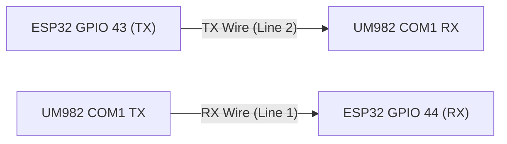

# ESP32 Serial Interface & CLI Guide

The GNSS Compass firmware features an interactive command-line interface (CLI) accessible concurrently over both the physical **USB-C serial port** and wireless **Bluetooth Low Energy (BLE UART)**. The CLI provides real-time GNSS receiver diagnostics, display self-test triggers, Rover Mode transit tracking, and antenna heading offset calibration stored in non-volatile storage (NVS).

---

## 1. Connection Options

### 1.1 Physical USB-C Connection

Connect the ESP32-S3 rotary display to your computer using a USB-C data cable.

| Parameter | Setting | Notes |
| :--- | :--- | :--- |
| **Port (Linux)** | `/dev/ttyACM0` (or `/dev/ttyACM1`) | Default USB CDC serial device |
| **Port (macOS)** | `/dev/cu.usbmodem*` | Native USB CDC port |
| **Port (Windows)** | `COMx` | Appears under Device Manager > Ports (COM & LPT) |
| **Baud Rate** | **115,200** | 8N1 (8 data bits, no parity, 1 stop bit) |
| **Flow Control** | None | Hardware and software flow control disabled |
| **Line Endings** | Any (`\r`, `\n`, or `\r\n`) | Firmware handles CR, LF, and CRLF transparently |

#### Terminal Emulator Recommendations (USB)
* **Linux / macOS:** `tio /dev/ttyACM0 -b 115200`, `picocom -b 115200 /dev/ttyACM0`, or `minicom -D /dev/ttyACM0 -b 115200`
* **Windows:** PuTTY, Tera Term, or Arduino Serial Monitor
* **Cross-Platform:** Visual Studio Code Serial Monitor extension

The CLI includes **local character echoing** and supports **backspace/DEL** editing directly in terminal emulators.

---

### 1.2 Wireless Bluetooth (BLE UART / Nordic NUS)

Because the Elecrow 2.1" display is often mounted on a mast, tripod, or vehicle dash with delicate rear cabling, the firmware provides a wireless Bluetooth interface using the industry-standard **Nordic UART Service (NUS)**.

> [!NOTE]
> The ESP32-S3 microcontroller utilizes **Bluetooth 5.0 Low Energy (BLE)**. BLE UART requires no pairing PIN, connects in under a second, and works natively across iOS, Android, and desktop browsers.

* **Advertised Device Name:** `GNSS-Compass-xxxxxx` (where `xxxxxx` is the last 6 lowercase hex digits of the Bluetooth MAC address, e.g. `GNSS-Compass-8a4f2b`).
* **Service UUID:** `6E400001-B5A3-F393-E0A9-E50E24DCCA9E`
* **RX Characteristic (Write to ESP32):** `6E400002-B5A3-F393-E0A9-E50E24DCCA9E`
* **TX Characteristic (Notify from ESP32):** `6E400003-B5A3-F393-E0A9-E50E24DCCA9E`

#### Android Mobile Connection
1. Install **[Serial Bluetooth Terminal](https://play.google.com/store/apps/details?id=de.kai_morich.serial_bluetooth_terminal)** by Kai Morich from Google Play.
2. Open sidebar -> **Devices** -> **Bluetooth LE** tab -> Scan -> Select `GNSS-Compass-xxxxxx`.
3. Tap Connect. The terminal connects immediately.
4. **Recommended Field Macro Buttons:** In the app, long-press the `M1`–`M6` macro buttons along the bottom to configure 1-tap commands:
   * **M1 (`status`):** `status\n` (Live GNSS receiver stream & lock diagnostics)
   * **M2 (`rover`):** `rover status\n` (16 km transit displacement & qualification)
   * **M3 (`cal snap`):** `cal snap\n` (1-touch antenna heading alignment snapshot)
   * **M4 (`history`):** `rover history\n` (Display visited contest grid roster)
   * **M5 (`undo`):** `rover undo\n` (Discard accidental stop and re-arm)
   * **M6 (`exit`):** `disconnect\n` (Cleanly release BLE radio link)

> [!TIP]
> For active microwave contest logging and remote target setting, see the **[Contest Voice Dictation Field Macro Profile](#3132-recommended-field-macro-button-configurations)** in Section 3.13.2.

> [!TIP]
> In *Serial Bluetooth Terminal*, go to **Settings -> Bluetooth LE** and verify that **"Close GATT on disconnect"** is enabled, or simply type `disconnect` in the terminal before switching devices to release the Bluetooth link immediately.

#### iPhone / iPad Connection
1. Install **[BLE Terminal HM-10](https://apps.apple.com/us/app/ble-terminal-hm-10/id1398703795)** or **[Adafruit Bluefruit Connect](https://apps.apple.com/us/app/adafruit-bluefruit-connect/id830125974)** from the App Store.
2. Scan and tap `GNSS-Compass-xxxxxx`.
3. Select **UART** mode. Bidirectional terminal access is active.

#### Laptop / Desktop (Web Bluetooth — Zero Software Installation)
You can connect directly from **Google Chrome**, **Microsoft Edge**, or **Chromium** on macOS, Linux, Windows, or ChromeOS without installing any desktop software or drivers using the Web Bluetooth API:

1. Open the open-source **[HTML-BLEserial](https://github.com/ednieuw/HTML-BLEserial)** Web Bluetooth terminal by ednieuw:
   * Clone or download the repository from [GitHub](https://github.com/ednieuw/HTML-BLEserial).
   * Double-click `BLE_UART_Terminal.html` (or `BLE_UART_Terminal-darktheme.html`) to open it directly in Chrome or Edge (can be run locally from disk or hosted on GitHub Pages).
2. Click the **CONNECT** button in the webpage.
3. Select `GNSS-Compass-xxxxxx` from the browser device prompt and click **Pair**.
4. You now have full bidirectional CLI access (`status`, `rover`, `target`, `log`, `cal`, `test`, `help`) directly within your browser tab.

---

## 2. Boot Output

Upon power-up or reboot, the ESP32 outputs initial startup identification and a summary prompt:

```text
GNSS Compass v1.0.0
Commands: 'status' (GPS stream diagnosis), 'test' (visual demo), 'sim' (simulation)
```

---

## 3. Command Reference

All commands are case-insensitive and can be issued interactively or piped via script.

### 3.1 Help Menu (`help` or `?`)
Displays a summary of available serial commands.

```text
> help

=== GNSS Compass Serial Commands ===
  status (or gps)       - Live GNSS receiver stream & link diagnostic
  gps probe             - Test bidirectional TX connection to UM982
  gps config [baseline <cm> [tol]]
                        - Run automated 5 Hz $KSXT receiver setup
  gps send <command>    - Send raw command to UM982 receiver
  gps check (or audit)  - Query receiver running parameters
  rover [status|start|stop|history|undo|max|clear]
                        - Rover transit tracking
  target <grid>         - Remote target grid setting (supports phonetics)
  log <call> [band/freq]- Voice-friendly contest QSO logging (10 GHz default)
  log [undo|del|list|stats|export|default|clear]
                        - QSO log management and contest export
  test (or demo)        - Run visual display self-test demo
  cal [snap|zero|<val>] - View or configure antenna calibration
  sim [on|off|hdg|pos|grid|rover|status]
                        - GPS simulation commands
  exit (or disconnect)  - Terminate wireless BLE connection cleanly
  restart (or reboot)   - Restart the ESP32 controller
  version (or ver)      - Display firmware build version and compile time
  ble [diag on|off]     - BLE link status / toggle BLE RF diagnostics
  ble suffix [<val>|reset]
                        - Configure BLE device name suffix (max 16 chars)
  $<NMEA/KSXT sentence> - Inject raw GNSS sentence directly
  help (or ?)           - Show this help menu
====================================
```

#### Top-Level CLI Command Reference

| Command | Subcommands / Arguments | Transport | Description |
| :--- | :--- | :--- | :--- |
| **`status`** *(or `gps`)* | None | USB, BLE | Live GNSS receiver stream & link diagnostic, RTK fix health |
| **`gps`** | `probe` \| `config` \| `check` \| `send <cmd>` | USB, BLE | UM982 receiver setup, TX line discovery, in-system config |
| **`rover`** | `status` \| `start` \| `stop` \| `history` \| `undo` \| `max` \| `clear` | USB, BLE | Rover transit tracking (16 km displacement rule & qualification) |
| **`target`** | `<grid>` *(supports NATO phonetics)* | USB, BLE | Remote target Maidenhead grid locator setting & bearing recalculation |
| **`log`** | `<call> [band/freq]` *(supports NATO phonetics)* | USB, BLE | Voice-friendly contest QSO logging (10 GHz default, phonetics & band auto-mapping) |
| **`log`** | `undo` \| `delete <#>` \| `clear` | USB, BLE | Contest QSO log editing, deletion, and rollback |
| **`log`** | `list` *(or `show`)* \| `stats` | USB, BLE | Formatted ASCII log table and contest statistics (DX, bands, grids) |
| **`log`** | `export <cabrillo\|adif\|csv>` | USB, BLE | Stream contest log export in ARRL Cabrillo 3.0, ADIF, or CSV |
| **`log`** | `default band <band>` \| `max <#>` | USB, BLE | Set contest default band and NVS QSO storage capacity (10–1000) |
| **`cal`** | `snap` \| `zero` \| `[set] <deg>` | USB, BLE | Antenna heading offset calibration |
| **`test`** *(or `demo`)* | None | USB, BLE | 9-stage visual display self-test demo |
| **`sim`** | `on` \| `off` \| `hdg` \| `pos` \| `grid` \| `rover` \| `status` | USB, BLE | GPS simulation mode and synthetic sentence injection |
| **`ble`** | `status` \| `suffix [<val>\|reset]` \| `diag on\|off` | USB, BLE | Bluetooth Low Energy diagnostics and device name customization |
| **`exit`** *(or `disconnect`)*| None | BLE | Clean wireless disconnect from the ESP32 side |
| **`restart`** *(or `reboot`)* | None | USB, BLE | Restart the ESP32 microcontroller |
| **`version`** *(or `ver`)* | None | USB, BLE | Display firmware version and build timestamp |
| **`$<sentence>`** | Raw NMEA / Unicore sentence | USB, BLE | Direct GNSS sentence injection into parser |
| **`help`** *(or `?`)* | None | USB, BLE | Display CLI help menu |

---

### 3.2 GNSS Stream Diagnostics (`status`, `gps`, `diag`, `s`, `g`)
Inspects the live incoming UART stream from the Unicore UM982 GNSS receiver (`Serial2` / GPIO 44). Outputs bidirectional link status, TX discovery capability, configuration health, byte counters, packet reception rates, fix conditions, and a link health verdict.

#### Example: Normal / RTK Fixed Lock with Bidirectional Link
```text
> status

========================================
     GNSS Receiver Stream Diagnosis     
========================================
Link Status:    CONNECTED (Bidirectional TX/RX Active)
TX Capability:  AVAILABLE (UM982 command responses confirmed)
Config State:   OPTIMAL ($KSXT streaming at 5.0 Hz, legacy unlogged)
Physical Link:  CONNECTED (Hardware Serial Link Active)
Total Bytes:    48291 (last byte 12 ms ago)

Message Streams:
  - $GNGLL (Position):   0 pkts (never)
  - $KSXT  (Navigation): 280 pkts (last 0.2s ago)
  - $HDT   (Heading):    0 pkts (never)

Data Fix Status:
  - Coordinates:         37.77490, -122.41940 (Grid: CM87wa92)
  - Dual-Antenna Heading: RTK FIXED (Pure White - High Precision)

Overall Verdict:        [PASS] FULLY OPERATIONAL (RTK Fixed)
========================================
```

#### Diagnostic Verdicts & Troubleshooting
| Verdict | Cause | Suggested Action |
| :--- | :--- | :--- |
| **`[PASS] FULLY OPERATIONAL (RTK Fixed)`** | Normal high-precision dual-antenna RTK heading. | None — operational. |
| **`[PASS - WARN] OPERATIONAL (RTK Float)`** | Carrier phase ambiguity unresolved (obstructed sky view or multipath). | Check for local obstructions or RF reflections near antennas. |
| **`[WAIT] POSITION LOCKED, WAITING FOR HEADING BASELINE`** | Position fix acquired, waiting for dual-antenna baseline carrier lock. | Allow 10–30 seconds with clear view of the sky. |
| **`[FAIL] NO GPS DATA STREAM DETECTED`** | No bytes received across UART in > 3000 ms. | 1. Verify GX12 cable is plugged in.<br>2. Check 5V / 12V power to receiver enclosure.<br>3. Check RX pin (GPIO 44) wiring to UM982 TX. |
| **`[FAIL] FRAMING / BAUD RATE MISMATCH`** | Bytes received, but no valid NMEA/Unicore packets decoded. | Check receiver baud rate (must match 115,200 baud 8N1). |

---

### 3.3 GNSS Transmitter Discovery & Configuration Commands (`gps`)

When the ESP32 transmitter line (GPIO 43) is wired to the UM982 receiver's COM1 RX line (via a 4-pin GX12 connector or internal jumper), the compass can probe transmitter presence, configure the receiver in-system, and query runtime parameters without disassembling the receiver enclosure or plugging into a computer:



#### 1. Discover TX Wire (`gps probe`)
The compass automatically discovers TX capability as soon as receiver stream data is detected on boot or upon cable connection. You can also manually trigger a discovery probe at any time:

```text
> gps probe
[GPS PROBE] Transmitting 'version' discovery probe on GPIO 43...
[GPS RX] <OK
[GPS RX] #VERSIONA,91,GPS,FINE,2320,150123000,0,0,18,0;UM982,R4.10Build11252*9543ab12
```

If the TX line is disconnected (legacy 3-wire setups), the probe times out safely after 2 retries and marks the link as `Receive-Only Mode`. Transmission-dependent operations are cleanly gated without affecting compass display or heading calculation.

#### 2. Automated In-System Receiver Setup (`gps config`)
Executes the verified multi-step configuration sequence from [RECEIVER.md](RECEIVER.md):
1. `MODE ROVER UAV` (Moving baseline / dual-antenna mode)
2. `CONFIG SIGNALGROUP 3 6` (GPS + BDS + GLONASS + Galileo multi-frequency tracking)
3. `UNLOG COM1` (Wipes all legacy and factory default sentences in a single command)
4. `KSXT com1 0.2` (Enables unified navigation message at 5 Hz)
5. `CONFIG HEADING FIXLENGTH` (Constrains heading calculation to a rigid fixed-length baseline for faster RTK lock)
6. `SAVECONFIG` (Commits RAM parameters to receiver non-volatile NOR Flash)
7. Stream verification (Confirms live `$KSXT` stream is active)

```text
> gps config
[GPS CONFIG] Initiating configuration pipeline (Standard 5 Hz $KSXT)...
[GPS CONFIG] Starting receiver configuration...
[GPS CONFIG] Settings saved. Verifying KSXT 5 Hz stream...
[GPS CONFIG] Complete! Receiver configured at 5 Hz KSXT.
```

> [!NOTE]
> **Built-In Flash Wear Protection:** To protect the receiver's NOR Flash from unnecessary write cycles or corrupted parameters, if any step prior to `SAVECONFIG` fails or times out, the sequence safely aborts without sending `SAVECONFIG`.

#### 3. Setup with Baseline Length Constraint (`gps config baseline <cm> [tol_cm]`)
Because `CONFIG HEADING FIXLENGTH` is standard, the receiver dynamically tracks fixed-length baseline spacing automatically. If your physical antenna spacing is known (e.g. 101.6 cm / 40 inches center-to-center with a default 2.5 cm tolerance), provide the baseline distance to add the length and tolerance constraint (`CONFIG HEADING LENGTH <cm> <tol_cm>`):

```text
> gps config baseline 101.6 2.5
[GPS CONFIG] Initiating configuration pipeline (Baseline: 101.6 cm, Tol: 2.5 cm)...
[GPS CONFIG] Starting receiver configuration...
[GPS CONFIG] Settings saved. Verifying KSXT 5 Hz stream...
[GPS CONFIG] Complete! Receiver configured at 5 Hz KSXT.
```

#### 4. Audit Running Receiver Parameters (`gps check` or `gps audit`)
Non-destructively queries the receiver's running settings (`VERSION`, `MODE`, `UNILOGLIST COM1`, and `HEADINGSTATUSA` for baseline constraint) to inspect firmware build, operating mode, active message logs, and configured baseline length/tolerance without writing to NOR Flash. If TX status has not yet been established at the time of query, `gps check` automatically initiates an in-flight probe on GPIO 43 and executes the query sequence as soon as the receiver acknowledges.

Intermediate `$command` echoes are suppressed during the audit, and incoming payloads are formatted into a clean status card:

```text
> gps check
[GPS AUDIT] Querying receiver parameters (VERSION, MODE, UNILOGLIST COM1, HEADINGSTATUSA)...

========================================
     GNSS Receiver Audit Report         
========================================
Hardware Model: UM982 (PN: HRPT00-S10C-P)
Serial Number:  2310415000012-LR23C1261413487
Firmware:       R4.10Build13495 (2024/04/02)
Operating Mode: ROVER UAV
COM1 Output:    KSXT COM1 0.2s (5 Hz)
Baseline Range: 101.6 cm (± 2.5 cm)  [CONSTRAINED]
Overall Config: [OK] Optimal for Dual-Antenna Compass
========================================
> 
```

#### 5. Send Raw Receiver Command (`gps send <cmd>`)
Power-user command allowing transmission of arbitrary Unicore ASCII commands directly to the receiver:

```text
> gps send uniloglist com1
[GPS TX] Sent: 'uniloglist com1'
[GPS RX] < KSXT COM1 0.200000
[GPS RX] <OK
```

---

### 3.4 Visual Display Self-Test (`test`, `demo`, `t`)
Triggers an automated visual demonstration on the round LCD screen. Runs sequentially through 9 test phases:

1. **Test 1: Same Grid Clamp** (ARRL 1.0 km minimum rule)
2. **Test 2: Under 1,000 km formatting** (~600 km geodetic distance)
3. **Test 3: Over 1,000 km formatting** (~2,500 km geodetic distance)
4. **Test 4: Extreme distance (> 10,000 km)** and recovery without ghost characters
5. **Test 5: Antenna Heading Quality Color States** (White / Yellow / Red)
6. **Test 6: Live GNSS Receiver Stream Diagnostic** (Direct hardware UART check)
7. **Test 7: Antenna Calibration Pill & Modal** (Offset fine-tuning & snap demo)
8. **Test 8: Rover Mode 4-State Qualification Matrix** (Transit, Qualified, Revisit, Lost)
9. **Test 9: Rover Location History & 1-Touch Undo Modal** (Discard progress demo)

After completion, the self-test prints a complete summary table with individual stage verdicts and an overall pass/fail status, then automatically restores live compass operation.

```text
> test

=== Starting Visual Display Self-Test Demo ===
[Test 1/9] Same Grid (ARRL 1.0 km rule)
[Test 2/9] Under 1,000 km formatting (~600 km)
[Test 3/9] Over 1,000 km formatting (~2,500 km)
[Test 4/9] Extreme distance (> 10,000 km) & Ghost Recovery
  -> Dropping back to 1.0 km (verifying no ghost characters)
[Test 5/9] Antenna Heading Quality Color States
  -> Bearing Color: Pure White (RTK Fixed)
  -> Bearing Color: Bright Yellow (RTK Float / Degraded)
  -> Bearing Color: Bright Red (Lost / Stale)
[Test 6/9] Live GNSS Receiver Stream Diagnostic
[Test 7/9] Antenna Calibration Pill & Modal Display Demo
  -> Testing Calibration Pill Display (Uncalibrated: OFF)
  -> Testing Calibration Pill Display (Calibrated: +4.2 deg)
  -> Demonstrating Calibration Modal Dialog
[Test 8/9] Rover Mode 4-State Qualification Matrix (Row 5 Card)
  -> State A: In Transit (< 16.0 km, Red on White)
  -> State B: Qualified New Grid (>= 16.0 km, Green on White)
  -> State C: Qualified Revisited Grid (>= 16.0 km, Blue on White)
  -> State D: GPS Lost / Stale (Amber status on White)
[Test 9/9] Rover Contest Location History & 1-Touch Undo Modal

==================================================
             Visual Self-Test Summary             
==================================================
  [1/9] Same Grid (ARRL 1.0 km rule)      : PASS
  [2/9] Under 1,000 km formatting         : PASS
  [3/9] Over 1,000 km formatting          : PASS
  [4/9] Extreme distance (> 10,000 km)    : PASS
  [5/9] Heading quality color states      : PASS
  [6/9] Live GNSS stream diagnostic       : PASS
  [7/9] Antenna calibration pill & modal  : PASS
  [8/9] Rover Mode 4-state matrix card    : PASS
  [9/9] Rover history log & undo modal    : PASS
--------------------------------------------------
Overall Verdict: ALL 9 TESTS PASSED [PASS]
==================================================
=== Visual Self-Test Complete (Live state restored) ===
```

---

### 3.5 Antenna Heading Calibration (`cal`)
Manages the non-volatile antenna alignment offset in degrees. The offset corrects for mechanical misalignment between the dual-antenna cross-boom and the microwave antenna feedline.

#### Display Current Calibration (`cal`, `cal status`, `cal show`)
```text
> cal

=== Antenna Calibration Status ===
  Stored Offset :  +3.5 deg
  Target Bearing:  48.2 deg
  Raw GNSS Hdg  :  44.7 deg
  Calibrated Hdg:  48.2 deg
==================================
```

#### Snap Calibration to Target (`cal snap`)
Aligns the compass heading to match the current target bearing (requires an active GNSS heading fix). Calculates $\text{offset} = \text{target} - \text{raw\_heading}$, normalizes to $[-180^\circ, +180^\circ]$, updates display, and saves to NVS.

```text
> cal snap
[CAL] Snapped! New offset: +3.5 deg
```
*If no GNSS heading fix is active, the command responds with:*
```text
[CAL ERROR] Cannot snap: No valid GNSS heading fix.
```

#### Reset Calibration to Zero (`cal zero`, `cal reset`, `cal 0`)
Clears any stored offset back to $0.0^\circ$ and updates NVS.

```text
> cal zero
[CAL] Offset reset to 0.0 deg (Cleared).
```

#### Set Specific Offset (`cal <value>` or `cal set <value>`)
Sets an exact manual offset in degrees. Angles are automatically normalized to $[-180^\circ, +180^\circ]$.

```text
> cal set +4.2
[CAL] Offset set to  +4.2 deg

> cal -12.5
[CAL] Offset set to -12.5 deg
```

---

### 3.6 GPS Data Simulation & Rover Test (`sim` and `$<sentence>`)

The simulation interface allows desktop verification of **Rover Mode**, transit displacement tracking (evaluating the **16 km legal rule** and grid boundary crossings), antenna needle motion, and RTK quality states without connecting the physical UM982 receiver or driving outside.

#### Simulation State Control
* `sim` or `sim status`: Displays simulation mode state, injected packet counts, simulated coordinates, heading, and rover alert status.
* `sim on`: Enables simulation mode and **suppresses physical receiver input on `Serial2`**, preventing real GNSS data from interfering with tests.
* `sim off`: Disables simulation mode and restores live communication with the UM982 receiver.

```text
> sim status

=== GPS Simulation Mode Status ===
  Simulation Active : YES (Hardware Serial2 suppressed)
  Sim Packets Recv  : 142
  Last Sim Packet   : 180 ms ago
  Current Heading   : 145.2 deg (Quality: FIXED)
  Current Position  :  38.35400, -119.45800 (Grid: CM87wa)
  Rover Mode Active : YES (<16k alert tracking)
  Rover Distance    :  14.8 km (Alert: ACTIVE (RED on WHITE))
==================================
```

#### Simulated Values & Quick Commands
* `sim hdg <deg> [fixed|float|lost]`: Updates simulated antenna heading and color quality.
  * Example: `sim hdg 145.2 fixed` (Pure white needle)
  * Example: `sim hdg 90.0 float` (Bright yellow needle)
  * Example: `sim hdg 270.0 lost` (Bright red needle)
* `sim pos <lat> <lon>`: Sets current geographic coordinates and calculates Maidenhead grid.
  * Example: `sim pos 38.354 -119.458`
* `sim grid <grid>`: Moves current position to the center of a Maidenhead grid.
  * Example: `sim grid CM87wa`
* `sim rover [origin_grid] <dist_km>`: Configures rover tracking from an origin grid and sets simulated vehicle distance.
  * Example: `sim rover CM87wa 14.5` (Row 5 highlights **RED on WHITE**, alert active: $< 16\text{ km}$)
  * Example: `sim rover CM87wa 16.5` (Alert clears, distance $\ge 16\text{ km}$)
* `sim time <hh:mm>`: Sets the simulated satellite UTC clock.
  * Example: `sim time 18:30`

#### Direct Sentence Injection (`$<sentence>`)
Any line sent across serial beginning with `$` is passed directly to the unified sentence parser, exactly as if received from the Unicore receiver:

```text
$KSXT,20261106202506.00,-122.12500000,37.02083333,2100.00,145.20,0.00,0.00,0.022,,1,3,28,28*1C
```

Injecting raw sentences automatically enables simulation mode (`simModeActive = true`).

---

### 3.7 Clean Wireless Disconnect (`disconnect`, `exit`, `quit`)
Terminates an active Bluetooth Low Energy session cleanly from the peripheral side:

```text
> disconnect
Disconnecting BLE connection...
```

This makes the ESP32 send a link-layer `LL_TERMINATE_IND`, closing any lingering background OS connection handle, and then restart BLE advertising so other phones, tablets, or browser sessions can connect without needing to toggle Bluetooth. The reply is delivered first: the link is closed once queued output has been sent (at most about 2 seconds later).

---

### 3.8 BLE Configuration & Diagnostics (`ble`)

#### Link Status (`ble` or `ble status`)

```text
> ble
[BLE] Device: GNSS-Compass-71c581
[BLE] Connected: yes | Subscribed: yes | MTU: 512
[BLE] Advertising: no
[BLE] TX queue: 0 / 12288 bytes | Dropped: 0 bytes | Send retries: 0
[BLE] Diagnostics: off
```

* **Subscribed:** the client has enabled notifications. Output is only sent to a subscribed client.
* **TX queue:** BLE output is buffered (12 KB) and sent in the background, so long reports never stall the compass. If the queue ever fills, further output is dropped until it drains, and the client sees `[BLE] N bytes of output dropped (send queue full)`. *Dropped* is the running total.
* **Send retries:** how often the Bluetooth stack was momentarily out of buffers and a packet had to be retried. It is harmless unless it keeps climbing quickly.

#### Customizing the BLE Device Suffix (`ble suffix`)
By default, the device name is `GNSS-Compass-xxxxxx`, derived from the last 6 characters of the ESP32's Bluetooth MAC address. When operating multiple compasses near each other at a contest summit, you can customize the suffix (up to 16 characters, e.g. your callsign, vehicle, or rover number):

```text
> ble suffix Rover1
[BLE] Device name updated to: GNSS-Compass-Rover1
[BLE] Saved to non-volatile storage.
[BLE] Note: If your phone still displays the old name, toggle your phone's Bluetooth off and on to clear its scan cache.
```

* **Query current suffix:** `ble suffix` displays the current name and active suffix.
* **Reset to default MAC:** `ble suffix reset` (or `ble suffix default`) removes the custom suffix and restores the hardware MAC default.
* **Length limit:** Maximum 16 characters (to ensure the Complete Local Name fits within the 29-byte BLE scan response payload limit with the fixed `GNSS-Compass-` prefix).
* **Phone Caching Note:** Mobile operating systems (especially iOS and Android) aggressively cache peripheral names by MAC address. If your phone continues displaying the previous name in its Bluetooth scanner list after changing the suffix, toggle Bluetooth off and on in your phone's quick settings to clear its device scan cache.

#### RF Diagnostics (`ble diag on|off`)
* `ble diag on|off`: prints RSSI every 3 s, main-loop stall reports, TX power, MTU, connection-parameter and congestion changes on the **USB** serial port. Connects, disconnects (with reason code) and advertising failures are always printed there.

---

### 3.9 System Restart (`restart` or `reboot`)
Restarts the ESP32-S3 microcontroller via software reset:

```text
> restart
[SYSTEM] Restarting ESP32 controller...
```

Accepts both `restart` and `reboot`. Over physical USB CDC or wireless BLE, the confirmation message is dispatched before triggering software reset via `esp_restart()`.

---

### 3.10 Firmware Version (`version` or `ver`)
Queries the compiled firmware version, Git commit hash, and build timestamp:

```text
> ver
GNSS Compass v0.3-dev+d73f187 (Built Nov 10 2026 17:48:12)
```

Useful over USB or Bluetooth Serial to instantly confirm which build is flashed to hardware.

---

### 3.11 Remote Target Setting (`target <grid>`)

During microwave and VHF/UHF contesting, operators frequently coordinate skeds with distant stations across different Maidenhead grid squares. Setting the target grid locator remotely via USB Serial or Bluetooth Low Energy eliminates having to reach up to the antenna mast, rotate physical dials, or touch the screen in harsh weather or bright sunlight.

#### Command Syntax
```text
target <grid>
```

* **Grid Formats:** Accepts 4-, 6-, or 8-character Maidenhead grid squares (e.g., `CM88`, `CM88qk`, `CM88qk24`).
* **Automatic Normalization:** Case-insensitive; lower-case input is automatically normalized to standard Maidenhead casing (e.g. `cm88qk` $\rightarrow$ `CM88qk`).
* **NATO Phonetics:** The built-in phonetic lexer parses spoken NATO phonetic alphabet words for noise-immune voice entry.
  * Plain text: `target CM88qk`
  * Spoken phonetics: `target charlie mike 88 quebec kilo` $\rightarrow$ `CM88qk`
  * 4-character grid: `target delta echo 09` $\rightarrow$ `DE09`
  * Segmented input: Handles spaces between characters naturally (e.g. `target c m 8 8 q k` $\rightarrow$ `CM88qk`).

#### Immediate Display & Geodesy Update
Upon receiving a valid target grid:
1. **Row 2 Update:** Row 2 of the 2.1" round display updates immediately to the new target locator.
2. **Needle Retargeting:** The dual-antenna compass needle immediately swings toward the new target station azimuth.
3. **Geodesy Recalculation:** Geodesic path distance (Row 4) and ARRL contest distance update immediately in real time.

#### Terminal Output Examples
```text
> target CM88qk
[TARGET] Target set to CM88qk (Bearing: 342.3 deg, Distance: 118.2 km)

> target charlie mike 88 quebec kilo
[TARGET] Target set to CM88qk (Bearing: 342.3 deg, Distance: 118.2 km)
```

If the grid is missing or invalid:
```text
> target
[TARGET ERROR] Missing grid square. Usage: target <grid> (e.g. 'target CM88qk' or 'target charlie mike 88 quebec kilo')

> target ZZ99
[TARGET ERROR] Invalid Maidenhead grid 'ZZ99'. Format: 4, 6, or 8 characters (e.g. 'CM88qk').
```

---

### 3.12 Voice-Friendly Contest QSO Logging (`log`)

Operating microwave gear on windy mountaintop turnouts with cold hands or heavy gloves makes traditional laptop keyboards or touchscreen logging awkward and error-prone. The `log` command suite provides a contest logging engine designed specifically to pair with Bluetooth Low Energy (BLE) and smartphone voice-to-text keyboards.

#### NATO Phonetics: The Key to Voice-to-CLI Logging
Standard smartphone speech-to-text keyboards (Google Gboard, Apple Dictation) transcribe spoken phonetics verbatim as individual words (e.g. *"kilo six mike golf"*) rather than converting them into callsign letters (`K6MG`). The firmware's built-in `VoiceQsoParser` bridges this gap: it translates NATO phonetic words, spoken numbers, common homophones ("won" $\rightarrow$ 1, "to" $\rightarrow$ 2, "for" $\rightarrow$ 4, "ate" $\rightarrow$ 8), and contest suffixes (`stroke rover` $\rightarrow$ `/R`, `portable` $\rightarrow$ `/P`) directly into clean contest callsigns and band identifiers.

When a contact is logged, the compass automatically snapshots all situational context directly from live GNSS receiver navigation:
1. **GPS UTC Timestamp:** GPS satellite epoch time (hours and minutes UTC).
2. **My Grid Locator:** Live 6/8-character Maidenhead grid derived from dual-antenna RTK coordinates.
3. **His Grid Locator:** Current target grid dialed in on the compass display.
4. **Geodesic Path Distance:** Exact distance in kilometers calculated via WGS84 ellipsoidal geodesy.
5. **Geodesic True Bearing:** True azimuth to target in degrees.

#### 3.12.1 Logging Contacts (`log <call> [band/freq]`)

Logging a contact requires only the callsign and an optional band or frequency:

```text
> log k6mg
[QSO LOGGED #15] K6MG | 10 GHz | 21:34z | CM87wa -> CM88qk (118.2 km @ 342 deg)

> log k6mg 24
[QSO LOGGED #16] K6MG | 24 GHz (24192.100 MHz) | 21:35z | CM87wa -> CM88qk (118.2 km @ 342 deg)

> log k6mg 10368.1
[QSO LOGGED #17] K6MG | 10 GHz (10368.100 MHz) | 21:36z | CM87wa -> CM88qk (118.2 km @ 342 deg)
```

#### 3.12.2 Spoken Bands, Frequencies, and NATO Phonetics

The built-in `VoiceQsoParser` provides robust natural dictation support:

* **Band Shorthand without "GHz":** Numbers in `{10, 24, 47, 76, 122, 134, 241}` are automatically recognized as microwave gigahertz bands without needing to say `"gigahertz"`:
  * `"log k6mg 10"` $\rightarrow$ 10 GHz (`10368.100 MHz`)
  * `"log k6mg 24"` $\rightarrow$ 24 GHz (`24192.100 MHz`)
  * `"log k6mg 47"` $\rightarrow$ 47 GHz (`47088.100 MHz`)
  * `"log k6mg 76"` $\rightarrow$ 76 GHz (`76032.100 MHz`)
  * `"log k6mg 122"` $\rightarrow$ 122 GHz (`122250.100 MHz`)
  * `"log k6mg 134"` $\rightarrow$ 134 GHz (`134928.100 MHz`)
  * `"log k6mg 241"` $\rightarrow$ 241 GHz (`241056.100 MHz`)
  * `"log k6mg laser"` (or `light`) $\rightarrow$ Laser / Sub-mm band
* **Frequency Auto-Mapping:** Spoken frequencies automatically resolve to their corresponding band:
  * `10368.1` $\rightarrow$ 10 GHz
  * `5760` / `5.7` $\rightarrow$ 5.7 GHz
  * `3456` / `3.4` $\rightarrow$ 3.4 GHz
  * `2304` / `2.3` $\rightarrow$ 2.3 GHz
  * `1296` / `1.2` $\rightarrow$ 1.2 GHz
  * `902` / `903` $\rightarrow$ 902 MHz
  * `432` $\rightarrow$ 432 MHz (70 cm)
  * `222` $\rightarrow$ 222 MHz (1.25 m)
  * `144` / `2m` $\rightarrow$ 144 MHz (2 m)
  * `50` / `6m` $\rightarrow$ 50 MHz (6 m)
* **Flexible Argument Order:**
  * Callsign first: `log k6mg 24`
  * Band first: `log 24 k6mg`
  * Frequency first: `log 10368.1 k6mg`
* **Default Band:**
  When no band or frequency is specified (`log k6mg`), the entry automatically logs under the configured default band (`10 GHz` by default, configurable via `log default band`).
* **NATO Phonetics & Spoken Digits:**
  * Full NATO phonetics: `"log kilo six mike golf"` $\rightarrow$ `K6MG`
  * Rover/Portable suffixes: `"log whiskey six oscar papa stroke rover 10"` $\rightarrow$ `W6OP/R` on 10 GHz; `"portable"` $\rightarrow$ `/P`.
  * Spoken digits and homophones: `"won"`/`"one"` $\rightarrow$ `1`, `"to"`/`"too"`/`"two"` $\rightarrow$ `2`, `"for"`/`"four"` $\rightarrow$ `4`, `"ate"`/`"eight"` $\rightarrow$ `8`, `"zero"` $\rightarrow$ `0`.
  * Automatic punctuation stripping: Trailing periods, colons, or commas inserted by smartphone voice engines are automatically cleaned while preserving internal decimal points (`10368.1`, `5.7`).

#### 3.12.3 Interactive Fallback Prompting (`log`)

If the operator sends or speaks `log` with no arguments, the CLI prompts for the missing callsign:

```text
> log
[QSO] Callsign? (e.g. 'K6MG' or 'Kilo Six Mike Golf', or 'cancel')
> k6mg 24
[QSO LOGGED #18] K6MG | 24 GHz (24192.100 MHz) | 21:38z | CM87wa -> CM88qk (118.2 km @ 342 deg)
```

* **Automatic Save on Input:** Once the required callsign (and optional band/frequency) is entered, the contact is automatically saved to NVS storage and confirmed on the display without requiring an extra "confirm/save" step.
* **Cancellation:** Type or speak `cancel` to abort without logging:
  ```text
  > cancel
  [QSO] Cancelled.
  ```
* **Natural Command Preemption:** Typing any standard CLI command (such as `status`, `rover`, `target`, `help`, or `cal`) immediately aborts the prompt and executes the command cleanly.

#### 3.12.4 Log Editing: Undo, Delete, and Clear

* **Quick Undo (`log undo`):**
  Removes the most recent QSO entry immediately:
  ```text
  > log undo
  [QSO LOG] Removed last entry #18 (K6MG on 24 GHz). Log contains 17 contacts.
  ```
  If the log is already empty:
  ```text
  [QSO LOG] Log is empty, nothing to undo.
  ```
* **Delete by Index (`log delete <#>` or `log del <#>`):**
  Deletes a specific entry by 1-based index and re-indexes remaining entries:
  ```text
  > log delete 3
  [QSO LOG] Deleted QSO #3 (W6OP/R on 10 GHz). Entries re-indexed (16 contacts remain).
  ```
* **Clear Entire Log (`log clear`):**
  Protected with a two-step confirmation to prevent accidental loss of contest data:
  ```text
  > log clear
  [QSO LOG] WARNING: This will permanently erase all contest QSO history!
  [QSO LOG] Type 'log clear confirm' (or 'yes') to proceed, or 'no' to abort.
  > yes
  [QSO LOG] Contest QSO log cleared (0 contacts).
  ```
  Single-step forced clear is also supported for scripting or macro buttons:
  ```text
  > log clear confirm
  [QSO LOG] Contest QSO log cleared (0 contacts).
  ```
  (Accepts `log clear confirm`, `log clear yes`, `log clear -y`, or `log clear force`).

#### 3.12.5 Log Inspection & Statistics (`log list`, `log stats`)

* **Display Log Table (`log list` or `log show`):**
  Prints a formatted ASCII table of all QSOs in memory:
  ```text
  > log list
  === Contest QSO Log (3 contacts) ===
  #   UTC   Callsign     Band     Freq (MHz)  My Grid   His Grid  Dist (km)  Az (deg)
  ----------------------------------------------------------------------------------
    1 21:34 K6MG         10 GHz   10368.100   CM87wa    CM88qk        118.2       342
    2 21:35 K6MG         24 GHz   24192.100   CM87wa    CM88qk        118.2       342
    3 21:38 W6OP/R       10 GHz   10368.100   CM87wa    CM87wb         42.5        85
  ==================================================================================
  ```
* **Contest Statistics (`log stats`):**
  Summarizes contest totals, unique callsigns, active band breakdown, cumulative DX distance, and maximum DX contact:
  ```text
  > log stats
  === Contest QSO Statistics ===
  Total Contacts : 3
  Unique Calls   : 2
  Bands Active   : 2 (10 GHz: 2, 24 GHz: 1)
  Total DX Dist  : 278.9 km
  Max DX Contact : 118.2 km (K6MG on 10 GHz)
  ==============================
  ```

#### 3.12.6 Contest Log Export (`log export <cabrillo|adif|csv>`)

Streams the contest log in standard formats over serial for easy saving to disk or clipboard:

* **ARRL Cabrillo 3.0 (`log export cabrillo` or `cab`):**
  Emits official ARRL 10 GHz and Up / VHF contest exchange records:
  ```text
  > log export cabrillo
  START-OF-LOG: 3.0
  CREATED-BY: GNSS Compass v0.3
  CONTEST: ARRL-10-GHZ
  QSO: 10G PH 2026-11-11 2134 K6MG CM87wa K6MG CM88qk
  QSO: 24G PH 2026-11-11 2135 K6MG CM87wa K6MG CM88qk
  QSO: 10G PH 2026-11-11 2138 W6OP/R CM87wa W6OP/R CM87wb
  END-OF-LOG:
  ```
* **Standard ADIF (`log export adif` or `adi`):**
  Emits standard amateur radio data interchange records with `<CALL>`, `<BAND>`, `<FREQ>`, `<QSO_DATE>`, `<TIME_ON>`, `<MY_GRIDSQUARE>`, `<GRIDSQUARE>`, `<DISTANCE>`, `<ANT_AZ>` for direct import into N1MM, Log4OM, MacLoggerDX, or LoTW:
  ```text
  > log export adif
  <ADIF_VER:5>3.1.4 <PROGRAMID:12>GNSS_COMPASS <EOH>
  <CALL:4>K6MG <BAND:3>3cm <FREQ:9>10368.100 <QSO_DATE:8>20261111 <TIME_ON:4>2134 <MY_GRIDSQUARE:6>CM87wa <GRIDSQUARE:6>CM88qk <DISTANCE:5>118.2 <ANT_AZ:3>342 <EOR>
  <CALL:4>K6MG <BAND:5>1.2cm <FREQ:9>24192.100 <QSO_DATE:8>20261111 <TIME_ON:4>2135 <MY_GRIDSQUARE:6>CM87wa <GRIDSQUARE:6>CM88qk <DISTANCE:5>118.2 <ANT_AZ:3>342 <EOR>
  ```
* **Comma-Separated Values (`log export csv`):**
  Emits tabular CSV format with column headers for analysis in Excel or Google Sheets:
  ```text
  > log export csv
  QSO,UTC_Timestamp,Callsign,Band,Freq_MHz,My_Grid,His_Grid,Distance_km,Bearing_deg
  1,1762904040,K6MG,10 GHz,10368.100,CM87wa,CM88qk,118.2,342.0
  2,1762904100,K6MG,24 GHz,24192.100,CM87wa,CM88qk,118.2,342.0
  ```

#### 3.12.7 Configuring Default Band & Storage Capacity

* **Default Band (`log default band <band>`):**
  Configures which band is logged when omitted in voice dictation. Saved permanently to NVS:
  ```text
  > log default band 24
  [QSO LOG] Default band updated to: 24 GHz (Saved to NVS).
  ```
  Query current default band:
  ```text
  > log default band
  [QSO LOG] Current default band: 10 GHz
  [QSO LOG] Usage: log default band <band> (e.g. 'log default band 24' or 'log default band 10 GHz')
  ```
* **Maximum Capacity (`log max <#>` or `log capacity <#>`):**
  Queries or sets the circular log ring buffer capacity (10 to 1000 entries, default: 200). Stored in NVS:
  ```text
  > log max 300
  [QSO LOG] Maximum capacity set to 300 QSOs (saved to NVS).
  ```

#### 3.12.8 On-Display QSO Confirmation Pop-Up Card

Whenever a contact is successfully committed via `log`, the ESP32-S3 firmware immediately triggers a high-contrast **QSO Pop-Up Card** on the 480×480 round LCD display:

```text
┌─────────────────────────────────────────────────────────┐
│                 480 x 480 Round Display                 │
│                                                         │
│               ┌─────────────────────────┐               │
│               │     *** QSO LOGGED ***  │               │
│               │                         │               │
│               │        K6MG / R         │  (Large Text) │
│               │                         │               │
│               │   10 GHz (10368.100)    │               │
│               │   CM88qk  -  118.2 km   │               │
│               │   Time: 21:34 UTC       │               │
│               │                         │               │
│               │       [  OK  ]          │  (Auto 10s)   │
│               └─────────────────────────┘               │
│                                                         │
└─────────────────────────────────────────────────────────┘
```

* **Heads-Up Verification:** The operator can verify that their spoken contact was logged accurately without taking their eyes off the antenna mast or picking up their phone.
* **10-Second Auto-Dismiss:** The card remains on screen for 10 seconds, then dismisses itself automatically, returning to the live compass needle view without stalling receiver tracking or RTK navigation.
* **Instant Dismissal:** Tapping the `[ OK ]` button, touching anywhere on the touch display, or turning/clicking the rotary knob closes the modal immediately.

---

### 3.13 Mobile Voice Dictation Field Guide & Macros

#### 3.13.1 Mobile Terminal Setup (iOS & Android)

##### Android (*Serial Bluetooth Terminal* + Google Gboard)
1. Open **[Serial Bluetooth Terminal](https://play.google.com/store/apps/details?id=de.kai_morich.serial_bluetooth_terminal)**.
2. Tap Sidebar $\rightarrow$ **Devices** $\rightarrow$ **Bluetooth LE** $\rightarrow$ Scan and connect to `GNSS-Compass-xxxxxx`.
3. Tap the text input bar to open your on-screen keyboard (e.g. Google Gboard).
4. Tap the **Microphone** icon on the keyboard.
5. Speak your logging command naturally: e.g. `"log k6mg 24"` or `"target charlie mike 88 quebec kilo"`.
6. Tap the keyboard Send button or enter key.

##### iOS (*BLE Terminal HM-10* / *Adafruit Bluefruit Connect* + Apple Dictation)
1. Open **[BLE Terminal HM-10](https://apps.apple.com/us/app/ble-terminal-hm-10/id1398703795)** or **[Adafruit Bluefruit Connect](https://apps.apple.com/us/app/adafruit-bluefruit-connect/id830125974)**.
2. Scan and tap `GNSS-Compass-xxxxxx`, then switch to **UART** mode.
3. Tap the text input box to display the iOS virtual keyboard.
4. Tap the **Microphone** icon in the bottom right corner of the keyboard.
5. Speak: `"log w6op stroke rover 10"` or `"target CM88qk"`.
6. Tap the send arrow.

#### 3.13.2 Recommended Field Macro Button Configurations

In *Serial Bluetooth Terminal* (Android), you can assign quick-action macros to the row of 6 buttons (`M1`–`M6`) across the bottom of the screen. Long-press any button to set its title and command string:

##### Profile A: Contest Logging & Target Dialing (Recommended for Contests)

| Macro Button | Name | Command String | Purpose / How to Use |
| :--- | :--- | :--- | :--- |
| **`M1`** | `log ` | `log ` *(trailing space, no `\n`)* | **1-Touch Command Prefix:** Inserts `"log "` into the input bar so you only type the callsign and band. |
| **`M2`** | `target ` | `target ` *(trailing space, no `\n`)* | **1-Touch Command Prefix:** Inserts `"target "` into the input bar so you only type the new grid locator. |
| **`M3`** | `undo` | `log undo\n` | **1-Tap Rollback:** Instantly removes the most recent QSO entry if logged accidentally. |
| **`M4`** | `stats` | `log stats\n` | **1-Tap Scoreboard:** Displays current contact count, unique callsigns, and cumulative DX. |
| **`M5`** | `status` | `status\n` | **1-Tap RTK Diagnostics:** Checks live GNSS satellite lock, baseline health, and coordinates. |
| **`M6`** | `cal snap` | `cal snap\n` | **1-Tap Heading Snap:** Instantly aligns antenna heading offset to the current target station. |

> [!TIP]
> Notice the distinction between **Prefix Macros** (`M1`, `M2`) and **Action Macros** (`M3`–`M6`). A prefix macro leaves the cursor in the input box so you only type the argument without retyping the command name, whereas an action macro ends with `\n` to execute immediately with a single tap. If speaking via voice dictation, it is usually faster to simply speak the full phrase (e.g. *"log k6mg"* or *"target CM88qk"*).

##### Profile B: Rover Transit Mode (For Traveling Rovers)

| Macro Button | Name | Command String | Purpose |
| :--- | :--- | :--- | :--- |
| **`M1`** | `status` | `status\n` | Receiver stream diagnostics & RTK fix quality |
| **`M2`** | `rover` | `rover status\n` | Rover 16 km transit displacement & qualification state |
| **`M3`** | `cal snap`| `cal snap\n` | Antenna alignment heading snapshot |
| **`M4`** | `history`| `rover history\n` | Display visited contest grid roster |
| **`M5`** | `undo` | `rover undo\n` | Discard accidental stop and re-arm transit tracking |
| **`M6`** | `exit` | `disconnect\n` | Cleanly release BLE radio link |

#### 3.13.3 Mountaintop Voice Dictation Tips

1. **Wind Noise Mitigation:**
   Microwave contest operating positions (mountain peaks, exposed ridgelines, coastal overlooks) frequently experience severe wind gusts. To prevent garbled speech-to-text recognition:
   * Use a wired or Bluetooth headset equipped with an electret boom microphone fitted with a dense foam windscreen.
   * If speaking directly into your smartphone, hold the microphone opening close to your mouth and cup your hand around it to shield against wind noise.
2. **Use Shorthand Band Numbers:**
   Speech recognition models frequently mistranslate the phrase `"gigahertz"`, generating phrases like `"giga hurts"` or other non-radio words. Speak plain numbers instead:
   * Say: `"log k6mg 24"` rather than `"log k6mg twenty-four gigahertz"`.
   * Say: `"log k6mg 10"` rather than `"log k6mg ten gig"`.
3. **NATO Phonetics for Difficult Callsigns:**
   While common callsigns are transcribed accurately when spoken naturally, letters with similar phonetics ("B", "D", "E", "P", "T", "V" or "M", "N") can be confused in noisy outdoor environments. Use NATO phonetics for 100% recognition:
   * Say: `"log whiskey six oscar papa stroke rover 10"` $\rightarrow$ parsed cleanly as `W6OP/R` on `10 GHz`.
4. **Natural Cadence:**
   Speak the command as a continuous phrase without hesitating between words:
   * Say: `"log k6mg 10"` or `"target charlie mike 88 quebec kilo"`.
5. **Heads-Up Verification:**
   After dictating, you do not need to look down at your smartphone screen. Simply look up at the round compass display on your tripod or mast — the 10-second confirmation modal displays the callsign, band, frequency, and distance in large high-contrast text.

---

## 4. Host Simulator Script (`tools/gps_sim.py`)

A comprehensive scenario-based simulation script is available in `tools/gps_sim.py`. It communicates directly with the ESP32 over `/dev/ttyACM0` (or auto-detected port).

### 4.1 Running Pre-Canned Scenarios

```bash
# 1. Rover transit journey (drives from CM87wa across 16 km boundary at 65 km/h)
./tools/gps_sim.py rover --origin CM87wa --speed 65 --distance 25

# 2. Mountain canyon switchback / backtrack scenario (handles distance decreases)
./tools/gps_sim.py backtrack --origin CM87wa

# 3. 360-degree antenna rotator sweep (validates needle fluidity and 0/360 wrap)
./tools/gps_sim.py sweep --speed 6.0

# 4. RTK quality degradation & watchdog timeout cycle
./tools/gps_sim.py rtk

# 5. Interactive terminal drive controller (WASD keyboard control)
./tools/gps_sim.py drive --origin CM87wa

# 6. Dry run (prints generated NMEA/$KSXT sentences to stdout without serial port)
./tools/gps_sim.py rover --dry-run
```

### 4.2 Custom Parameter & Sentence Injection (`inject`)

The `inject` subcommand provides one-shot or sustained injection of custom coordinates, headings, simulated rover distances, UTC timestamps, and raw sentences.

| Argument | Description | Example |
| :--- | :--- | :--- |
| `--grid GRID` | Center on Maidenhead grid (4, 6, or 8 chars) | `--grid CM87wa` |
| `--lat LAT`, `--lon LON` | Set exact decimal geographic coordinates | `--lat 38.3540 --lon -119.4580` |
| `--hdg HDG` | Antenna heading in degrees (0–360) | `--hdg 145.2` |
| `--quality, -q` | RTK quality: `fixed` (white), `float` (yellow), `lost` (red) | `-q fixed` |
| `--duration, -d SEC` | Hold duration in seconds to continuously stream packet (prevents 1.5s staleness timeout) | `-d 10.0` |
| `--time, -t TIME` | Set simulated UTC clock display (`HH:MM` or `HH:MM:SS`) | `-t 21:45` |
| `--rover-origin GRID` | Origin grid for rover distance testing | `--rover-origin CM87wa` |
| `--rover-dist KM` | Simulated rover displacement distance from origin in km | `--rover-dist 14.5` |
| `--repeat, -r N` | Number of packets to send (default: 1) | `-r 5` |
| `--rate HZ` | Streaming rate in Hz for `--duration` or `--repeat` (default: 5.0) | `--rate 5.0` |
| `--altitude ALT` | Altitude in meters (default: 2100.0) | `--altitude 1850.0` |
| `--sats SATS` | Number of tracked satellites (default: 28) | `--sats 32` |
| `--raw RAW` | Direct injection of an arbitrary raw NMEA or `$KSXT` sentence | `--raw '$GNGLL,...'` |

#### Injection Examples

```bash
# 1. Quick coordinate and heading injection (Pure white fixed needle)
./tools/gps_sim.py inject --grid CM87wa --hdg 145.2 --quality fixed

# 2. Hold heading and position on screen for 10 seconds (prevents 1.5s watchdog timeout)
./tools/gps_sim.py inject --grid CM87wb --hdg 90.0 --quality fixed --duration 10

# 3. Simulate rover displacement relative to an origin (evaluates 16 km alert threshold)
./tools/gps_sim.py inject --rover-origin CM87wa --rover-dist 14.5 --hdg 45.0 --duration 15

# 4. Set specific UTC time on the clock display (Row 6)
./tools/gps_sim.py inject --grid CM87wa --time 23:45

# 5. Test degraded RTK reception (Bright yellow float needle)
./tools/gps_sim.py inject --grid CM87wa --hdg 210.0 --quality float --duration 8

# 6. Inject an arbitrary raw NMEA or $KSXT sentence directly
./tools/gps_sim.py inject --raw '$GNGLL,3821.24,N,11927.48,W,183000.00,A*23'
```

---

## 5. Scripting & Automation Examples

### Bash / Shell Quick Query
You can query the device directly from a Linux/macOS shell:

```bash
# Query live status
echo "status" > /dev/ttyACM0 && head -n 20 /dev/ttyACM0

# Zero out calibration
echo "cal zero" > /dev/ttyACM0
```

### Python Script Example
```python
import serial
import time

ser = serial.Serial('/dev/ttyACM0', 115200, timeout=2)
time.sleep(1)  # Allow CDC connection to stabilize

# Send status command
ser.write(b"status\n")

# Read response until prompt or timeout
while True:
    line = ser.readline().decode('utf-8', errors='ignore')
    if not line:
        break
    print(line, end='')

ser.close()
```
