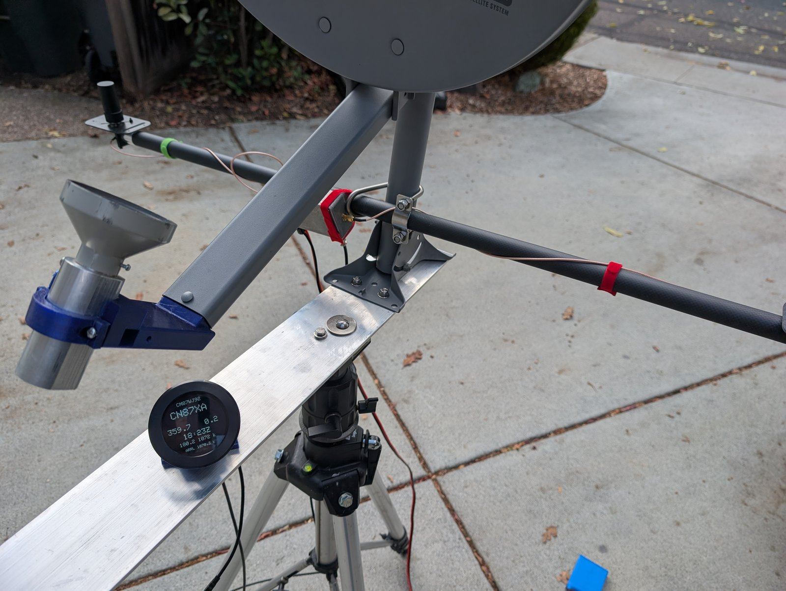
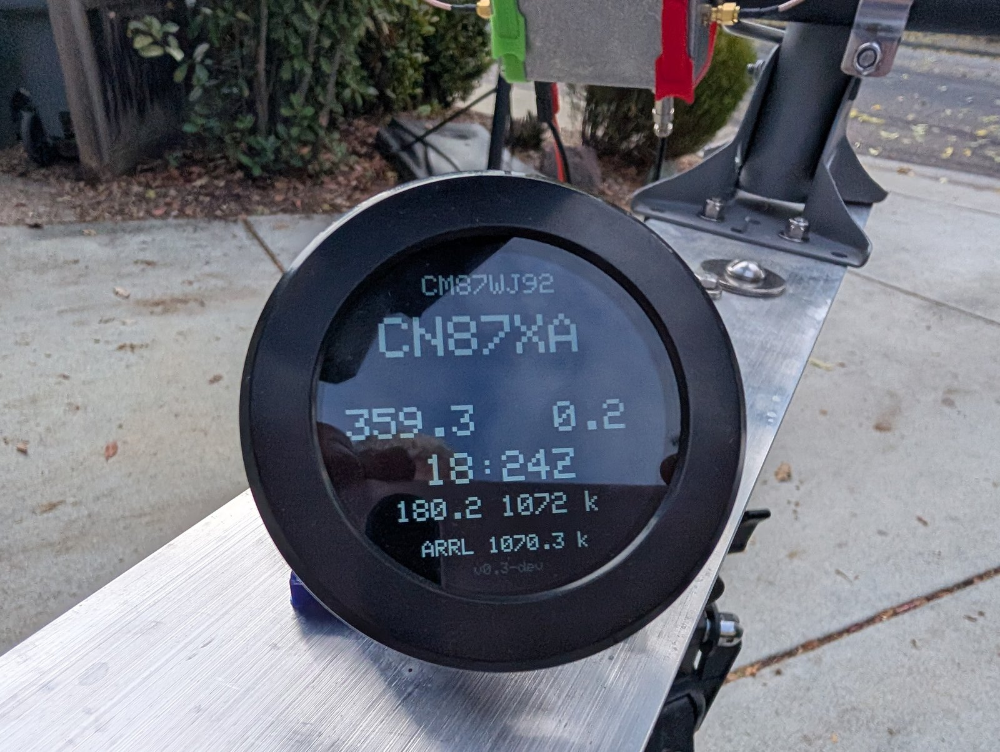

# GNSS Compass User's Guide (Outline & Photo Plan)

> **Document Status:** Draft Outline for Review  
> **Target Audience:** Field operators, VHF/UHF/Microwave rover operators, and home station builders.  
> **Formatting Note:** Image tags (`![...]`) indicate proposed photos and diagrams. Each image includes a *Photo Specification* describing the framing, shot details, and callouts to capture.

---

## Table of Contents
1. [Overview & Motivation](#1-overview--motivation)
2. [Hardware & Antenna Setup](#2-hardware--antenna-setup)
3. [Display Layout & Screen Anatomy](#3-display-layout--screen-anatomy)
4. [Operating Controls (Touch & Rotary Dial)](#4-operating-controls-touch--rotary-dial)
5. [Antenna Heading & RTK Quality Indicators](#5-antenna-heading--rtk-quality-indicators)
6. [Microwave Rover & Contest Features](#6-microwave-rover--contest-features)
7. [On-Device Testing & Verification](#7-on-device-testing--verification)
8. [USB Serial Diagnostics & Troubleshooting](#8-usb-serial-diagnostics--troubleshooting)
9. [Quick Reference Cheat Sheet](#9-quick-reference-cheat-sheet)

---

## 1. Overview & Motivation

### Why Dual-Antenna GNSS? (The Motivation)
Operating weak-signal VHF, UHF, and microwave bands—especially portable on mountaintops or as a mobile rover—demands exact antenna pointing. At microwave frequencies (such as 10 GHz or 24 GHz), dish beamwidths can be just a few degrees wide. Traditional methods for determining antenna azimuth have significant operational drawbacks:
* **Beacon Calibration Delays:** Operators often have to hunt for known distant beacons or reference stations to align or recalibrate mechanical antenna rotators. If a beacon is off the air or obstructed by terrain, calibration is stalled.
* **Magnetic Distortion:** Magnetic compasses and fluxgate sensors are notoriously unreliable near vehicle sheet metal, masts, iron towers, and high-current power cables.
* **Cluttered Operating Desks:** In the field, an operator typically has to juggle multiple disparate tools: a rotator direction indicator, a handheld GPS for grid squares, a laptop or smartphone app for great-circle bearing and distance calculations, and a separate master clock for UTC log timing.

**The GNSS Compass replaces all of this with a single, self-contained instrument:**
1. **Zero Calibration Required:** By measuring the carrier-phase difference of satellite signals between two matched antennas (interferometry), the unit calculates **true azimuth heading accurate to $< 0.5^\circ$** with $0.1^\circ$ resolution from first principles. It requires no alignment against beacons, no magnetic compensation, and no recalibration after transport.
2. **All-in-One Operating Telemetry:** It integrates real-time antenna azimuth, target bearing calculation, reverse bearing, geodesic distance, official ARRL contest scoring distance, live 8-digit Maidenhead grid locators, and atomic-synchronized UTC time—all visible on one high-contrast circular display.

*Photo 1 Specification: Wide desk or field operating shot showing the rotary display unit powered on, showing live heading and grid squares next to a radio or rotator controller.*

### 30-Second Quick Start:
1. **Apply Power:** Connect 5V / 12V DC power. The 2.1" round display initializes in $< 2$ seconds.
2. **Acquire GNSS Heading Lock:**
   * On initial boot, heading shows `---.-` (White) while the receiver locks satellite signals.
   * Within 30–60 seconds outdoors, heading transitions to **Yellow** (RTK Float), and then **Pure White** (RTK Fixed).
3. **Aim Your Antenna:** Turn your antenna rotator until the **Live Heading (left)** matches the **Target Bearing (right)**.

---

## 2. Hardware & Antenna Setup

*Photo 2 Specification: Boom/mast installation showing the two helical or patch GNSS antennas mounted in line with the microwave dish/Yagi boom. Annotated with arrows indicating:*
* *ANT1 (Primary / Position antenna — typically rear)*
* *ANT2 (Secondary / Heading antenna — typically front)*
* *Baseline distance dimension arrow ($\ge 0.5\text{ m}$ / $50\text{ cm}$)*
* *Forward pointing vector aligned with RF beam axis.*

### Key Alignment Rules:
* **Baseline Orientation:** The line from ANT1 (primary) to ANT2 (secondary) defines your $0^\circ$ baseline heading vector. Mount both antennas parallel to your RF antenna's main beam axis.
* **Separation Distance:** Maintain the configured baseline length (typically $0.5\text{ m}$ to $1.0\text{ m}$).
* **Unobstructed Sky View:** Ensure both antennas have an identical, clear view of the sky above $10^\circ$ elevation.

---

## 3. Display Layout & Screen Anatomy

The 480×480 full-color circular display organizes critical navigation and station telemetry into seven functional rows:

*Photo 3 Specification: Clear, close-up, high-contrast photo or direct capture of the 480×480 display in active operation, with numbered callout bubbles for each of the 7 rows.*

| Row | Function | Example Display | Description |
|:---:|:---|:---:|:---|
| **1** | **Local Grid** | `CM87wa00` | 8-digit Maidenhead locator calculated from live GPS coordinates. Tap when leaving a site to track departure distance in Rover mode. |
| **2** | **Target Grid** | `FN31pr` | 6-digit destination grid square. The yellow caret (`^`) marks the active character being edited. |
| **3** | **Live Heading & Target Azimuth** | `142.6  142.8` | **Left:** Real-time antenna heading ($0.0^\circ$–$359.9^\circ$). **Right:** Great-circle azimuth to target grid. |
| **4** | **UTC Clock** | `19:45 Z` | High-precision Universal Coordinated Time derived from GNSS atomic clocks. |
| **5** | **Reverse Bearing & Distance** | `322.8  3892 k` | **Left:** Azimuth from target grid back to you. **Right:** Geodesic distance in kilometers ($km$). |
| **6** | **ARRL Contest Distance** | `ARRL 3892.4 k` | Official contest distance between grid centers (includes 1.0 km minimum rule for same-grid contacts). |
| **7** | **Version & Status Footer** | `v0.3` | Firmware release identifier. Tap row to launch on-device visual self-test. |

---

## 4. Operating Controls (Touch & Rotary Dial)

Operation is fast and hands-on, combining capacitive touchscreen gestures with an incremental rotary encoder bezel.

*Photo 4 Specification: Two-panel or split photo:*
* *(a) Finger touching the 3rd character of the target grid on the touchscreen.*
* *(b) Hand rotating the outer rotary dial bezel, showing the yellow caret (`^`) and changed character.*

### Setting the Target Grid Square:
1. **Select Character (Touch):** Tap directly on any of the 6 characters in **Row 2** (Target Grid).
   * A bright yellow caret (`^`) appears directly beneath the tapped character.
   * The selected character turns yellow, indicating edit mode is active.
2. **Change Value (Dial):** Rotate the outer bezel:
   * **Positions 1 & 2 (Field):** Cycles letters `A` through `R`.
   * **Positions 3 & 4 (Square):** Cycles digits `0` through `9`.
   * **Positions 5 & 6 (Subsquare):** Cycles letters `A` through `X`.
3. **Auto-Lock Timeout:** If no controls are touched for **5 seconds**, edit mode automatically locks, and the yellow caret disappears to prevent accidental changes while operating.

---

## 5. Antenna Heading & RTK Quality Indicators

Row 3 (left value) indicates the real-time physical heading of your antenna boom. The font color provides immediate feedback on the carrier-phase RTK navigation solution:

*Photo 5 Specification: Side-by-side or composite photo showing the three heading states on the actual display:*
* *(a) Pure White heading (`142.6`): RTK Fixed lock.*
* *(b) Bright Yellow heading (`142.6`): RTK Float lock.*
* *(c) Bright Red heading or dashes (`---.-`): Stale / lost baseline alert.*

### Interpreting Heading States:
* ⚪ **Pure White (`142.6`) — RTK Fixed (Optimal):**
  * Both antennas have locked full integer carrier-phase ambiguity.
  * Azimuth accuracy is $< 0.5^\circ$ ($0.1^\circ$ resolution). Ready for microwave narrow-beam pointing.
* 🟡 **Bright Yellow (`142.6`) — RTK Float (Acquiring):**
  * Dual-antenna baseline is tracking satellites, but solving fractional carrier ambiguities.
  * Heading is usable for general VHF/UHF orientation while the receiver converges to full Fixed mode.
* 🔴 **Bright Red / `---.-` — Lost / Watchdog Alarm:**
  * Baseline lost (e.g. antenna blocked, coaxial disconnect, or high multipath).
  * If valid heading packets cease for more than **1.5 seconds**, the display automatically drops to Red or `---.-` to prevent operating on frozen, stale bearing data.

---

## 6. Microwave Rover & Contest Features

Designed by and for active VHF/UHF/Microwave operators, the compass includes specialized features for rover navigation and ARRL contest scoring.

*Photo 6 Specification: Close-up of the display showing Row 5 inverted in solid red with white text (`322.8  14 k`) indicating the operator has driven 14 km from the departing rover site and remains within the 16 km transit restriction threshold.*

### One-Tap Rover Site Departure Tracking:
* **The Rover Workflow:** When packing up and **leaving an operating site**, tap **Row 1 (Local Grid)** right as you depart.
* **What Happens:** 
  * Tapping Row 1 snapshots your departure coordinates and copies your 6-digit grid into Row 2 (Target Grid).
  * It activates real-time Rover transit tracking (`rovdist = true`).
* **En-Route Navigation:** As you drive toward your next operating location, **Row 5** continuously calculates and displays your real-time distance and reverse bearing from the site you just left.

### The 16 km Rover Transit Alert:
* **The Rule:** Amateur radio contest rules (such as the ARRL VHF/UHF contests) require rovers to travel at least **16 km (~9.9 miles)** between contacts when operating again from the same grid square.
* **Visual Warning (< 16 km):** While driving away, Row 5 displays an inverted **Red Background with White Text** (e.g., `322.8  14 k`) as long as you are still within 16 km of your departure point.
* **Transit Cleared (≥ 16 km):** The moment you cross the 16 km threshold, Row 5 automatically reverts to normal white text on black background, giving the driver/navigator instant visual confirmation that the contest distance requirement has been fulfilled.

### ARRL Contest Distance Scoring:
* **Row 6** displays the official ARRL contest distance between grid centers.
* Automatically implements the ARRL contest minimum distance rule ($1.0\text{ km}$ minimum for contacts within the same 6-digit subsquare).

---

## 7. On-Device Testing & Verification

No laptop or external tools are required to verify the display, touchscreen, and calculations.

*Photo 7 Specification: Photo of the circular display showing the green rounded status card banner `[ PASS ] ALL TESTS OK` displayed across the center.*

### Running the Visual Self-Test:
1. **Trigger:** Tap directly on **Row 7 (Firmware Version Footer)** at the bottom of the screen.
2. **Automated Sequence:** The unit runs through six automated checks:
   * **Test 1:** Same Grid Distance ($1.0\text{ km}$ ARRL minimum rule).
   * **Test 2:** Geodesic Distance & Round-Trip Symmetry ($3892.4\text{ km}$).
   * **Test 3:** Grid Boundary & Cardinal Bearing Verification ($0.0^\circ, 90.0^\circ, 180.0^\circ, 270.0^\circ$).
   * **Test 4:** Character erasure and layout alignment.
   * **Test 5:** Rover 16 km threshold alarm triggering.
   * **Test 6:** Live GNSS receiver stream integrity check.
3. **Result:** Displays a green `[ PASS ] ALL TESTS OK` card before cleanly restoring live operating telemetry.

---

## 8. USB Serial Diagnostics & Troubleshooting

Connecting the USB Type-C port to any PC, Mac, or terminal emulator (115,200 baud, 8N1) provides a comprehensive ASCII diagnostic console.

*Photo 8 Specification: Clean screenshot of a terminal window showing the output of the `status` command, highlighting packet counts, physical link status, and RTK verdict.*

### Available Terminal Commands:
* `status` (or `gps`, `diag`): Generates a comprehensive receiver stream health report.
  * Verifies hardware serial link continuity and total bytes received.
  * Validates NMEA and `$KSXT` packet rates and timestamp freshness.
  * Identifies baud rate mismatches or loose wiring.
* `test`: Runs the visual display self-test remotely.
* `help` (or `?`): Displays the serial command reference menu.

---

## 9. Quick Reference Cheat Sheet

*Photo 9 Specification: Photo of the rear enclosure showing the 3-pin GX12 connector, USB-C jack, and label indicating pin assignments (1: Power, 2: Ground, 3: Serial RX).*

### Touch & Bezel Cheat Sheet:
* **Tap Row 1:** Tap when leaving a site to track departure transit distance.
* **Tap Row 2:** Select digit in target grid for rotary editing.
* **Rotate Bezel:** Increment / decrement active character.
* **Wait 5s:** Automatically locks grid editing.
* **Tap Row 7:** Run display & sensor self-test.

### Color Reference:
| Color | Meaning |
|:---|:---|
| **White Heading** | RTK Fixed Lock ($< 0.5^\circ$ accurate) |
| **Yellow Heading** | RTK Float (Acquiring integer lock) |
| **Red Heading / `---.-`** | Stale / Lost signal (alarm watchdog active) |
| **Red Background (Row 5)** | Rover Transit Alert ($< 16\text{ km}$ from origin) |
| **Yellow Text / Caret** | Edit mode active |

