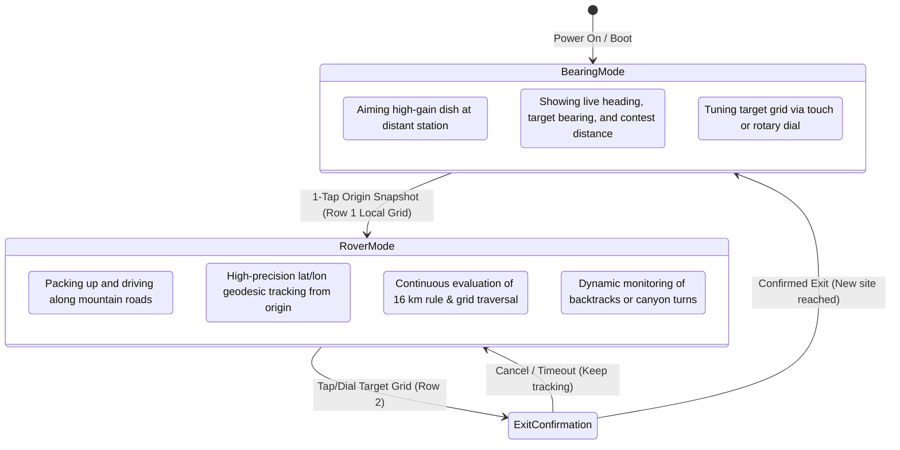
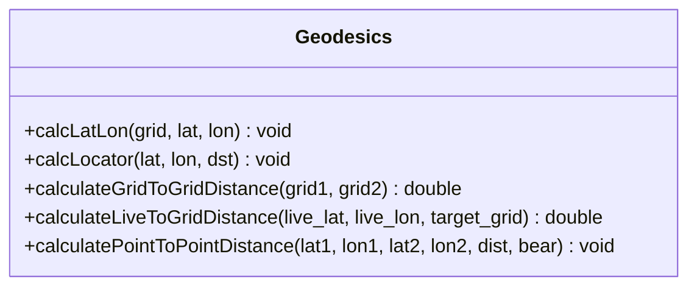

# Rover Mode, Transit Tracking, Location History & Distance Engine — Technical Design

* **Feature:** Dual Operational Modes (Bearing vs. Rover), Dynamic 16 km Displacement Tracking, Grid Traversal Detection, Multi-Stop Location History, and Modular Geodesic Engine
* **Status:** Draft / Proposed
* **Target Hardware:** ESP32-S3 (16 MB Flash, 8 MB OPI PSRAM), 480×480 Round Touch Display (ST7701S RGB + CST8XX I2C Touch), Rotary Encoder (CLK/DT)
* **Supersedes:** Earlier v0.2 single-alert design

---

## 1. Executive Summary & Operational Philosophy

In amateur microwave weak-signal contesting (e.g., the **ARRL 10 GHz and Up Contest** and **ARRL VHF/UHF Contests**), roving stations operate in two fundamentally distinct states:



1. **Bearing Mode (Stationary Operation):**
   The station is stationary at an operating location. The operator rotates the mast to aim high-gain antennas/dishes at distant targets, monitoring live antenna heading, target azimuth, and target distance.
2. **Rover Mode (In-Transit Relocation):**
   The station has torn down equipment and is driving along mountain roads, fire roads, or highways to the next operating site. Bearing to distant targets is irrelevant; the critical tasks are:
   - Tracking exact displacement from the last operating location against the **ARRL 16 km legal rule**.
   - Monitoring physical traversal across Maidenhead grid square boundaries.
   - Dynamic awareness of backtracking (e.g., switchbacks, missed turns, dead-ends).
   - Logging visited locations across the contest weekend.

---

## 2. Rover Mode: User Experience & Transit Tracking

### 2.1 Entering Rover Mode: One-Tap Origin Snapshot
Rover Mode is triggered deliberately when packing up from a site:

```text
[Row 1 Tap] -> Local Grid "CM87wa22" (Tap hit zone: X: 100-340, Y: 0-75)
```

1. **Snapshot Coordinates:** Captures current live GPS decimal coordinates $(\text{lat}_0, \text{lon}_0)$ to high double precision (derived directly from `$GNGLL` / `$KSXT`).
2. **Snapshot Grid:** Copies `mygrid` (6-char or 8-char) into the origin reference buffer `origin_grid`.
3. **Timestamp:** Records UNIX/GPS epoch departure timestamp.
4. **Target Display Reflection:** The target grid field (Row 2) displays the origin grid being tracked against, with a distinct **"ROVER TRANSIT"** indicator.
5. **Mode Engagement:** Firmware transitions `operationalMode = MODE_ROVER`.

---

### 2.2 Continuous Dynamic Tracking & Dual Qualification Criteria

In contest roving, site validity depends on two independent geodetic criteria:

$$\text{Criterion 1: Straight-Line Displacement } \Delta D \ge 16.0\text{ km}$$
$$\text{Criterion 2: Grid Boundary Traversal } \text{current\_grid}[0..5] \neq \text{origin\_grid}[0..5]$$

#### Displacement Calculation
Unlike stationary target distances that use grid centers, Rover Mode calculates the exact **WGS-84 geodesic distance** between the snapshot origin coordinates $(\text{lat}_0, \text{lon}_0)$ and the live GPS antenna coordinates $(\text{lat}_{\text{gps}}, \text{lon}_{\text{gps}})$:

$$\Delta D = \text{GeodesicWGS84}(\text{lat}_0, \text{lon}_0, \text{lat}_{\text{gps}}, \text{lon}_{\text{gps}})$$

Formatted with decimal precision when close:
- $\Delta D < 10.0\text{ km}$: displayed as `%4.1f km` (e.g., ` 4.2 km`, ` 9.8 km`).
- $\Delta D \ge 10.0\text{ km}$: displayed as `%4.1f km` (e.g., `15.8 km`, `16.4 km`, `22.1 km`).

#### Grid Boundary Traversal Check
The firmware evaluates `strncmp(mygrid, origin_grid, 6)` continuously. When the rover physically crosses the boundary of the 6-character subsquare (or 4-character field), the UI signals the transition immediately.

#### Dynamic Qualification Matrix

| State | Displacement $\Delta D$ | Grid vs. Origin | Visual Indication | Operating Legality |
| :--- | :--- | :--- | :--- | :--- |
| **A: Same Grid Under 16k** | $< 16.0\text{ km}$ | Identical (`CM87wa`) | **Solid Red background, White text** | **ILLEGAL** (Keep driving) |
| **B: New Grid Under 16k** | $< 16.0\text{ km}$ | Traversed (`CM87wb`) | **Warm Amber / Yellow alert** | **WARN** (New grid, but $< 16\text{ km}$) |
| **C: Same Grid Over 16k** | $\ge 16.0\text{ km}$ | Identical (`CM87wa`) | **Cyan / Amber alert** | **WARN** ($\ge 16\text{ km}$, but still in same grid) |
| **D: Qualified New Site** | $\ge 16.0\text{ km}$ | Traversed (`CM87wb`) | **Vibrant Green banner, White text** | **QUALIFIED** (Legal operating location) |

---

### 2.3 Dynamic Backtrack & Hysteresis Handling

Mountain transit rarely occurs in a straight line. An operator driving through canyons or climbing mountain roads may:
1. Reach $16.2\text{ km}$ straight-line displacement on a ridge.
2. Turn down a switchback or side road looking for a safe pullout, causing straight-line distance to drop back to $15.7\text{ km}$.
3. Accidentally clip back into the prior grid boundary.

**Design Rule: Instantaneous, Hysteresis-Free Reversibility**
- The system **never "latches"** qualification.
- If $\Delta D$ drops from $16.1\text{ km} \to 15.9\text{ km}$, the state drops immediately from **Qualified (Green)** back to **Under-16k (Red/Amber)**.
- The operator always knows their exact legal status at the moment they come to a stop.

---

### 2.4 Ending Rover Mode & Accidental Exit Safety

Ending Rover Mode signifies that the vehicle has parked, the mast will be deployed, and the operator is ready to aim antennas at distant stations.

#### Exit Trigger
Rover Mode ends when the operator sets a **new target grid square**:
- By tapping a character in Row 2 and rotating the rotary encoder knob.
- Or selecting a preset summit from the target preset list (future feature).

#### Accidental Touch Protection: Hardware Push-Button Confirmation
While driving over rough terrain, vibrations or stray objects (cables, coats) could brush the touchscreen. An accidental screen touch must not exit Rover Mode or erase the live origin tracking baseline while driving.

**Mechanism: Physical Push-Button Arbitration**
- In Rover Mode, tapping Row 2 or turning the encoder does **not** instantly switch to target editing.
- Instead, the display surfaces an on-screen prompt:
  ```text
  +--------------------------------------------+
  |    CLICK ROTARY KNOB TO FINISH TRANSIT     |
  |  (Physical push-button confirms arrival)   |
  +--------------------------------------------+
  ```
- **To Confirm Exit:** The operator must physically press down on the **rotary encoder push-button**. This positive, tactile hardware action guarantees deliberate intent to end transit.
- **Cancel / Auto-Timeout:** Tapping the screen or 8 seconds of inactivity cancels the prompt, maintaining Rover Mode without interruption.
- Upon confirmed push-button exit:
  1. The completed transit stop is automatically appended to the **Rover Location History Log** (NVS).
  2. The system transitions cleanly back to **Bearing Mode** and unlocks the target grid editor for dish alignment.

---

## 3. Multi-Stop Rover Location History & Contest Log

As rovers travel between multiple summits across a contest weekend, the device maintains a persistent chronological history of operating locations.

```text
[Stop 1: CM87wa (Home QTH)] ──(24.2 km)──> [Stop 2: CM87wb (Mt. Diablo)] ──(38.5 km)──> [Stop 3: CM88ec (Mt. Saint Helena)]
```

### 3.1 Data Model (`RoverStop`)

```cpp
struct RoverStop {
    uint32_t timestamp;        // GPS epoch timestamp (seconds)
    double   latitude;         // Decimal latitude of operating site
    double   longitude;        // Decimal longitude of operating site
    char     grid[9];          // 8-character Maidenhead locator (e.g. "CM87wa22")
    float    displacement_km;  // Verified straight-line km from immediate prior stop
    bool     qualified_16km;   // Whether the move met the 16 km requirement
};
```

Stored in ESP32 Non-Volatile Storage (`Preferences.h`) under namespace `"rover_log"`:
- Capacity: `#define MAX_ROVER_STOPS 20` (defaults to 20 stops; easily scalable to 50 or 100+ by updating this single constant).
- Storage footprint: $20 \times 32\text{ bytes} \approx 640\text{ bytes}$ (negligible in the 16 MB NOR flash partition).

---

### 3.2 "Undo / Discard Last Entry" & Automatic Rover Re-Arm

In real field operations, rovers frequently encounter unviable summits:
- The gate to a radio site is locked.
- Dense fog, freezing rain, or 50 mph winds prevent raising the dish mast.
- Extreme RF noise or trees block microwave line-of-sight.

If the operator had already clicked the knob to end rover transit at that summit, that unviable site would be recorded as the latest stop. If they then pack up and move to a third site, the displacement would incorrectly calculate relative to the *unviable* stop rather than the *previous legitimate operating site*.

**The "Discard Last Stop" Action & Automatic State Transition:**
- The operator opens the History menu and selects **"Discard Last Stop"** (via serial CLI `rover undo` or on-screen history menu).
- The unviable stop is removed from the NVS log.
- The active origin reference immediately **falls back to the previous legitimate stop's coordinates and grid**.
- **Automatic Re-Entry into Rover Mode:** The system automatically re-arms **Rover Mode** with respect to that restored prior stop! As the rover resumes driving toward an alternative location, continuous displacement $\Delta D$ instantly recalculates relative to the original valid site without requiring the operator to manually re-snapshot or configure anything.

---

### 3.3 Historical Grid Duplication Warning

While ARRL microwave contest rules do not require being 16 km away from *all* past locations (only the *immediate prior* location), operating from a grid square already activated earlier in the weekend has specific scoring constraints (e.g., stations cannot work the same contact on the same band from the same grid twice).

**Visual Presentation:**
When the rover arrives at a site with $\ge 16.0\text{ km}$ displacement, but the current grid matches an earlier stop in the contest log:
- **Card Color:** Qualified **Vibrant Green** (confirming legal 16 km displacement was achieved).
- **Advisory Badge:** Overlaid with an informational warning text:
  ```text
  [ QUALIFIED - NOTE: CM87wa ACTIVATED AT 14:22Z ]
  ```
This gives the operator immediate confidence that the 16 km move is legally satisfied while alerting them to check band logs before repeating contacts.

---

## 4. Distance Engine & Geodesics Architecture (Modularization)

To eliminate code duplication, circular dependencies, and Arduino preprocessor declaration order issues, all geodetic math will be extracted into a modular, decoupled engine:

```text
src/
├── geodesics/
│   ├── Geodesics.h           # Clean C++ class & pure function prototypes
│   └── Geodesics.cpp         # Implementations (WGS-84, Spherical, Maidenhead)
```

### 4.1 The Three Geodesic Calculations



#### 1. Grid-to-Grid Spherical Distance (`calculateGridToGridDistance`)
- **Use Case:** Stationary Bearing Mode (Default display distance next to reverse bearing).
- **Model:** Spherical Earth with $R = 6371.2\text{ km}$ (matching ARRL distance calculation standard).
- **Rule:** If `strncasecmp(grid1, grid2, 6) == 0`, returns **`0.0 km`**.
- **Rounding:** Formatted with `round()` to integer kilometers (`%4i k`).

#### 2. Live GPS to Target Grid Geodesic (`calculateLiveToGridDistance`)
- **Use Case:** Stationary Bearing Mode (Configurable via `dist latlon`).
- **Model:** WGS-84 ellipsoidal / Haversine geodesic from current live GPS coordinate to target grid center.
- **Rounding:** Formatted with `floor()` to integer kilometers (`%4i k`).

#### 3. High-Precision Point-to-Point Geodesic (`calculatePointToPointDistance`)
- **Use Case:** Rover Mode Displacement Tracking ($\Delta D$) and antenna back-azimuth.
- **Model:** Direct geodesic between $(\text{lat}_1, \text{lon}_1)$ and $(\text{lat}_2, \text{lon}_2)$ in meters.
- **Precision:** Double-precision meters, rendered with $0.1\text{ km}$ resolution.

---

## 5. Screen Layout & Visual Design (480×480 Circular Display)

### 5.1 Bearing Mode vs. Rover Mode UI Budget

```text
           --- BEARING MODE (Stationary) ---                          --- ROVER MODE (In-Transit) ---
                      (Y = 0)                                                   (Y = 0)
                   .-----------.                                             .-----------.
                .-'   Row 1     '-.                                       .-'   Row 1     '-.
              .'  Local Grid:     '.  Y=35                              .'  Local Grid:     '.  Y=35
             /     CM87wa22         \                                  /     CM87wb44         \
            |        Row 2           | Y=95                           |        Row 2           | Y=95
            |   Target: CM97be       |                                |  Origin: CM87wa        |
            |        Row 3           | Y=223                          |        Row 3           | Y=223
            |  Hdg: 142  Tgt: 142    |                                |  TRANSIT STATUS BANNER |
            |        Row 4           | Y=300                          |        Row 4           | Y=300
             \   UTC: 18:42:15 Z    /                                  \   DISPLACEMENT: 17.4k /
              '.     Row 5        .'   Y=370                            '.     Row 5        .'   Y=370
                '-.  Rev: 322  42k -'                                     '-. GRID: TRAVERSED -'
                     (Y = 480)                                                 (Y = 480)
```

### 5.2 Rover Mode Visual Status States

#### Row 3: Status Card & Row 4: Displacement Meter

1. **State 1: In-Transit Under 16 km (Red on White Warning)**
   - Row 3 Banner: `[ TRANSIT: UNDER 16 KM ]` (Red background, White text)
   - Row 4 Displacement: `DIST:  6.4 km` (Bold Red, Size 6)
   - Row 5 Grid Status: `GRID: SAME (CM87wa)` (Red text)

2. **State 2: Grid Boundary Crossed, but Under 16 km (Amber Alert)**
   - Row 3 Banner: `[ NEW GRID / UNDER 16 KM ]` (Amber background, Black text)
   - Row 4 Displacement: `DIST: 12.8 km` (Amber, Size 6)
   - Row 5 Grid Status: `GRID: NEW (CM87wb)` (Cyan text)

3. **State 3: Fully Qualified New Location (Green Qualified Banner)**
   - Row 3 Banner: `[ LEGAL SITE QUALIFIED ]` (Vibrant Green, Black text)
   - Row 4 Displacement: `DIST: 18.2 km` (Pure White, Size 6)
   - Row 5 Grid Status: `GRID: NEW (CM87wb)` (Green text)

---

### 5.3 Exit Confirmation Dialog

When Row 2 is tapped while in Rover Mode:

```text
        +-----------------------------------+
        |       FINISH ROVER TRANSIT?       |
        |                                   |
        |  Site: CM87wb44  Dist: 18.2 km   |
        |  Status: LEGAL SITE QUALIFIED     |
        |                                   |
        |  [ CANCEL (Wait) ]  [ SAVE & EXIT ]|
        +-----------------------------------+
```
- **"CANCEL":** Remains in Rover Mode (no changes).
- **"SAVE & EXIT":** Commits stop to History log, sets up target grid editing, switches to Bearing Mode.

---

### 5.4 Rover History Review Modal

Accessible via a dedicated serial command (`rover log`, `rover undo`, `rover clear`) or long-pressing Row 1:

```text
=== Rover Contest Location History ===
[#1] 14:15Z  CM87wa00  Origin (Home QTH)
[#2] 16:42Z  CM87wb55  +24.2 km  [QUALIFIED]
[#3] 19:10Z  CM88ec12  +38.5 km  [QUALIFIED]  <-- Current
--------------------------------------
Actions: [Discard Last Entry]  [Clear Entire Log]
```

---

## 6. Serial CLI Commands for Rover Operations

Expanding the serial interface ([`SERIAL.md`](../../SERIAL.md)) to support rover monitoring and test automation:

| Command | Action | Output / Behavior |
| :--- | :--- | :--- |
| `rover` / `rover status` | Displays active rover transit status | Origin coords, live displacement, grid boundary status, and qualification state |
| `rover start` | Emulates Row 1 tap | Captures current location as origin and arms Rover Mode |
| `rover stop` | Confirms transit completion | Commits location to history and returns to Bearing Mode |
| `rover log` | Prints contest history | Table of all visited summits, timestamps, coordinates, and displacements |
| `rover undo` | Discards last stop | Discards most recent entry and restores previous origin baseline |
| `rover clear` | Clears history | Resets contest log (with confirmation) |

---

## 7. Verification & Automated Test Strategy

1. **Host-Side Pure Math Tests (`tests/test_calculations.cpp`):**
   - WGS-84 point-to-point geodesic accuracy against known geodetic benchmarks.
   - Dual-condition qualification truth table (States A, B, C, D).
   - Dynamic backtrack tests (asserting displacement drop clears qualified state).
   - History stack operations (append stop, undo/fallback baseline, clear all).
   - Historical grid duplication detection.
2. **On-Device Self-Test Integration (`runVisualSelfTest`):**
   - Incorporate Rover Mode transit progression and exit confirmation dialog into the automated LCD self-test demo sequence.
3. **CI Firmware Pipeline:**
   - Verify headless modular build of `Geodesics.cpp` across ESP32-S3 targets.
