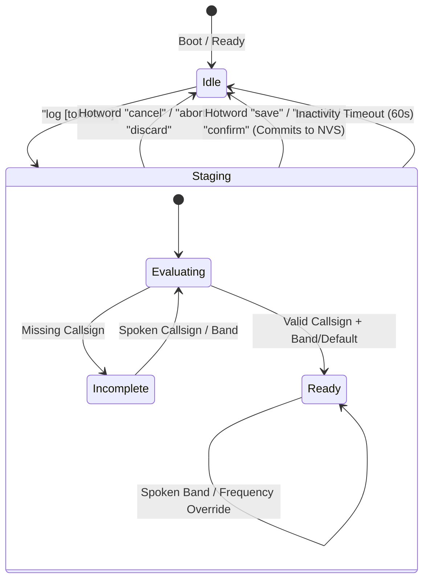

# Voice-Friendly Contest QSO Logging — Technical Design

* **Feature:** Voice-Dictated Contest QSO Logging via Bluetooth Low Energy & USB Serial
* **Status:** Proposed / Ready for Review
* **Target Hardware:** ESP32-S3 (16 MB Flash, 8 MB OPI PSRAM), Elecrow 2.1" Round Touch Display (480×480)
* **Architecture Base:** Modular C++ Architecture (`src/protocol/serial_cli.h`, `src/system/app_controller.h`)
* **Associated Docs:** [Serial CLI Guide](../../SERIAL.md), [Bluetooth Serial Design](../bluetooth-serial/DESIGN.md), [Rover Mode Design](../rover-transit/DESIGN.md)

---

## 1. Executive Summary & Field Motivation

During amateur microwave and VHF/UHF contests (such as the ARRL 10 GHz and Up Contest, ARRL June/September VHF contests, and microwave sprint events), operators frequently deploy portable or rover stations to mountain summits, coastal overlooks, and roadside turnouts.

Operating in these environments imposes extreme physical constraints:
* Operators are actively peaking dish azimuth/elevation, listening for faint CW/SSB signals near the noise floor, or working through wind and harsh sunlight.
* Entering log data via laptop keyboards or smartphone touchscreens in high ambient glare while wearing gloves or holding gear is slow, error-prone, and distracting.
* Most microwave contacts take place on a single primary band (**10 GHz**), with occasional coordinated escalations to higher/lower bands (e.g. 5.7 GHz, 24 GHz).

```
                      ┌──────────────────────────────────────────────┐
                      │    Smartphone (Voice Dictation / Gboard)     │
                      │   "log n9dk 10 GHz"   /   "save it"          │
                      └───────────────────────┬──────────────────────┘
                                              │ BLE UART (NUS)
                                              ▼
┌─────────────────────────────────────────────────────────────────────────────────┐
│ ESP32-S3 GNSS Compass Firmware                                                  │
│                                                                                 │
│   ┌─────────────────────┐       ┌───────────────────────────────────────────┐   │
│   │   LineBuffer / BLE  │  ──>  │      VoiceQsoParser                       │   │
│   └─────────────────────┘       │  - Strips dictation punctuation           │   │
│                                 │  - NATO phonetics ("November 9 Delta...") │   │
│                                 │  - Flexible order (call first / band 1st) │   │
│                                 │  - Freq -> Band auto-mapping (10368->10G) │   │
│                                 │  - Default band logic (10 GHz)            │   │
│                                 └─────────────────────┬─────────────────────┘   │
│                                                       │                         │
│                                                       ▼                         │
│   ┌─────────────────────┐       ┌───────────────────────────────────────────┐   │
│   │ Live Station State  │  ──>  │      Interactive Staging Engine           │   │
│   │ - My Grid (GPS)     │       │  - Partial input prompts (what's missing) │   │
│   │ - Target Grid (UI)  │       │  - Hotwords: "save" / "save it" / "cancel"│   │
│   │ - UTC Time (GNSS)   │       │  - Presents ready entry for voice approval│   │
│   │ - Dist & Bearing    │       └─────────────────────┬─────────────────────┘   │
│   └─────────────────────┘                             │                         │
│                                                       ▼                         │
│                                 ┌───────────────────────────────────────────┐   │
│                                 │      QsoLogManager (NVS Storage)          │   │
│                                 │  - Persistent QSO ring buffer (NVS)       │   │
│                                 │  - Cabrillo / ADIF / CSV export           │   │
│                                 │  - 'log list', 'log stats', 'log undo'    │   │
│                                 └───────────────────────────────────────────┘   │
└─────────────────────────────────────────────────────────────────────────────────┘
```

The GNSS Compass already continuously computes and maintains the critical situational context required for contest logging:
1. **My Grid Locator:** Real-time 6/8-character Maidenhead grid derived from dual-antenna GNSS RTK/GPS fixes.
2. **His Grid Locator:** Target grid square currently selected and dialed in on the compass display.
3. **UTC Timestamp:** Precise GPS-synchronized date and time (hours, minutes, seconds, epoch).
4. **Geodesics:** Exact geodesic path distance (km) and true bearing (azimuth).

By combining the newly implemented **Bluetooth Serial Interface (BLE UART)** with the voice dictation built into modern smartphone keyboards (Google Gboard, Apple iOS Dictation), the operator can simply tap the microphone icon in their mobile terminal and speak natural commands like:
> **"log n9dk 10 GHz"** $\rightarrow$ **"save it"**

This design details the conversational state machine, phonetics lexer, band/frequency deduction rules, default 10 GHz operation, non-volatile log storage, and Cabrillo/ADIF export capabilities.

---

## 2. Voice User Experience & Conversational State Machine

Mobile voice-to-text dictation is fast but occasionally omits words or transcribes punctuation. The logging engine must therefore be **error-tolerant, conversational, and reversible**.



### 2.1 Scenario Walkthroughs

#### Scenario A: Standard One-Shot Voice Log (Callsign + Band)
The operator speaks the callsign and band in any order:
* **Spoken input:** `"log n9dk 10 GHz"` *(or `"log 10 GHz n9dk"`)*
* **Compass terminal output:**
  ```text
  [QSO READY]
    Callsign: N9DK
    Band:     10 GHz (10368.100 MHz)
    UTC Time: 21:34z
    My Grid:  CM87wa
    His Grid: CM88qk (Target)
    Geodesy:  118.2 km @ 342 deg
  --------------------------------------------------
  Say 'save' (or 'save it') to log, or 'cancel' to discard.
  > 
  ```
* **Operator speaks:** `"save it"` *(or `"save"`, `"confirm"`, or simply hits Send)*
* **Compass terminal output:**
  ```text
  [QSO LOG] Logged #14: N9DK on 10 GHz in CM88qk (118.2 km). 73!
  > 
  ```

---

#### Scenario B: 10 GHz Default Band Mode (Two Spoken Words Total)
Because 10 GHz accounts for the vast majority of microwave contacts, the system defaults to 10 GHz when no band is specified:
* **Spoken input:** `"log n9dk"`
* **Compass terminal output:**
  ```text
  [QSO READY]
    Callsign: N9DK
    Band:     10 GHz [Default]
    UTC Time: 21:35z
    My Grid:  CM87wa  ->  His Grid: CM88qk
    Geodesy:  118.2 km @ 342 deg
  --------------------------------------------------
  Say 'save' to confirm 10 GHz, speak band/freq to change, or 'cancel'.
  > 
  ```
* **Operator speaks:** `"save"`
* **Result:** Contact logged in NVS. Total operator effort: **two spoken words**.

---

#### Scenario C: Exact Frequency Provided in Digits
When an operator wants to log the exact operating frequency (e.g. 10368.100 MHz, 5760.100 MHz, 24192.100 MHz):
* **Spoken input:** `"log n9dk 10368.1"` *(or `"log 10368.100 n9dk"`)*
* **Compass terminal output:**
  ```text
  [QSO READY]
    Callsign: N9DK
    Band:     10 GHz
    Freq:     10368.100 MHz
    UTC Time: 21:36z
    My Grid:  CM87wa  ->  CM88qk
  Say 'save' to confirm, or 'cancel'.
  > 
  ```
* **Operator speaks:** `"save"`
* **Result:** Both the frequency (`10368.100 MHz`) and the derived band (`10 GHz`) are committed to the log entry.

---

#### Scenario D: Partial Input & Clarification Prompts
If the operator begins without specifying a callsign:
* **Spoken input:** `"log"`
* **Compass terminal output:**
  ```text
  [QSO] Callsign? (e.g. 'N9DK' or 'November Nine Delta Kilo', or 'cancel')
  > 
  ```
* **Spoken input:** `"n9dk"`
* **Compass terminal output:**
  ```text
  [QSO READY]
    Callsign: N9DK
    Band:     10 GHz [Default]
    ...
  Say 'save' to confirm, or 'cancel'.
  > 
  ```

---

#### Scenario E: Immediate Cancellation via Hotword
If the operator changes their mind or speech recognition garbles the callsign:
* **Spoken input:** `"cancel"` *(or `"abort"`, `"discard"`, `"stop"`)*
* **Compass terminal output:**
  ```text
  [QSO] Log entry discarded.
  > 
  ```
* The staging buffer is wiped, and the CLI returns immediately to standard prompt mode.

---

## 3. Phonetics Lexer & Voice Dictation Normalizer

Mobile voice dictation engines (Gboard / iOS) introduce speech-to-text variations. The `VoiceQsoParser` normalizes input through a multi-pass pipeline:

### 3.1 Punctuation & Speech-to-Text Filtering
1. **Preserve Decimal Points:** Digits with internal decimal points (`10368.100`, `10.368`, `5.7`) are preserved.
2. **Strip Extraneous Punctuation:** Commas, colons, semicolons, question marks, exclamation marks, and trailing periods inserted by phone keyboards are stripped:
   * `"log n9dk, 10 GHz."` $\rightarrow$ `"log n9dk 10 GHz"`

### 3.2 NATO Phonetic Translation
Operators frequently speak callsigns phonetically in high-noise environments. The parser recognizes standard NATO phonetics and collapses consecutive phonetic words into a callsign string:

| Spoken Token | Mapped Character |
| :--- | :--- |
| `alpha`, `alfa` | **A** |
| `bravo` | **B** |
| `charlie` | **C** |
| `delta` | **D** |
| `echo` | **E** |
| `foxtrot` | **F** |
| `golf` | **G** |
| `hotel` | **H** |
| `india` | **I** |
| `juliet`, `juliett` | **J** |
| `kilo` | **K** |
| `lima` | **L** |
| `mike` | **M** |
| `november` | **N** |
| `oscar` | **O** |
| `papa` | **P** |
| `quebec` | **Q** |
| `romeo` | **R** |
| `sierra` | **S** |
| `tango` | **T** |
| `uniform` | **U** |
| `victor` | **V** |
| `whiskey` | **W** |
| `x-ray`, `xray` | **X** |
| `yankee` | **Y** |
| `zulu` | **Z** |

### 3.3 Spoken Numbers & Homophones
Phone dictation often writes numbers as words or substitutes common homophones:
* `zero` $\rightarrow$ `0`
* `one`, `won` $\rightarrow$ `1`
* `two`, `to`, `too` $\rightarrow$ `2`
* `three`, `tree` $\rightarrow$ `3`
* `four`, `for` $\rightarrow$ `4`
* `five`, `fife` $\rightarrow$ `5`
* `six` $\rightarrow$ `6`
* `seven` $\rightarrow$ `7`
* `eight`, `ate` $\rightarrow$ `8`
* `nine` $\rightarrow$ `9`

### 3.4 Rover & Portable Suffixes
* `stroke rover`, `slash rover`, `rover` $\rightarrow$ `/R`
* `stroke portable`, `slash portable`, `portable` $\rightarrow$ `/P`
* `stroke 6`, `slash 6` $\rightarrow$ `/6`

**Example:**
* Input: `"November nine delta kilo stroke rover"` $\rightarrow$ Parsed callsign: `N9DK/R`
* Input: `"whiskey six oscar papa"` $\rightarrow$ Parsed callsign: `W6OP`

---

## 4. Band & Frequency Mapping Rules

When numeric digits are provided, the parser automatically checks if they correspond to an amateur frequency and maps them to the appropriate contest band:

| Spoken / Typed Frequency | Logged Frequency | Inferred Band | ARRL Cabrillo Band Code |
| :--- | :--- | :--- | :--- |
| `10368`, `10368.1`, `10.368 GHz` | `10368.100 MHz` | **10 GHz** | `10G` |
| `24192`, `24192.1`, `24 GHz` | `24192.100 MHz` | **24 GHz** | `24G` |
| `47088`, `47 GHz` | `47088.100 MHz` | **47 GHz** | `47G` |
| `5760`, `5760.1`, `5.7 GHz` | `5760.100 MHz` | **5.7 GHz** | `5.7G` |
| `3456`, `3400`, `3.4 GHz` | `3456.100 MHz` | **3.4 GHz** | `3.4G` |
| `2304`, `2400`, `2.3 GHz` | `2304.100 MHz` | **2.3 GHz** | `2.3G` |
| `1296`, `1296.1`, `1.2 GHz` | `1296.100 MHz` | **1.2 GHz** | `1.2G` |
| `902`, `903`, `902 MHz` | `902.100 MHz` | **902 MHz** | `902` |
| `432`, `432.1`, `432 MHz` | `432.100 MHz` | **432 MHz** | `432` |
| `222`, `222.1`, `222 MHz` | `222.100 MHz` | **222 MHz** | `222` |
| `144`, `144.2`, `144 MHz` | `144.200 MHz` | **144 MHz** | `144` |
| `50`, `50.1`, `50 MHz` | `50.100 MHz` | **50 MHz** | `50` |

*Note: If the operator specifies arbitrary digits (e.g. `10368.250`), the exact numeric frequency is retained and stored in the QSO record.*

---

## 5. Default Band Configuration

To eliminate having to speak `"10 GHz"` on every contact:
* **Default Setting:** `10 GHz` is active by default upon initial boot.
* **CLI Configuration:**
  ```text
  > log default band 10 GHz
  [QSO] Default band set to 10 GHz.
  
  > log default band 24 GHz
  [QSO] Default band set to 24 GHz.
  
  > log default band none
  [QSO] Default band disabled (band must be specified).
  ```
* **Persistence:** Stored in NVS under `"qso_cfg"` with key `"def_band"`.

---

## 6. Data Model & Non-Volatile Storage (`QsoLogManager`)

Following the architecture of `RoverLogManager`, QSO records are stored in a dedicated NVS namespace (`"qso_log"`).

### 6.1 Binary Record Layout (`QsoEntry`)

```cpp
#pragma pack(push, 1)
struct QsoEntry {
    uint32_t timestamp;        // GPS UTC epoch timestamp (seconds)
    char     callsign[12];     // Target callsign (e.g. "N9DK/R\0")
    char     band[8];          // Band identifier (e.g. "10 GHz\0")
    uint32_t freq_khz;         // Frequency in kHz (e.g. 10368100), 0 if band-only
    char     my_grid[9];       // Operator Maidenhead grid at QSO time (e.g. "CM87wa\0")
    char     his_grid[9];      // Target Maidenhead grid at QSO time (e.g. "CM88qk\0")
    float    distance_km;      // Geodesic path distance in km
    float    bearing_deg;      // Geodesic true bearing in degrees
};
#pragma pack(pop)
```

* **Size per Entry:** Exactly **48 bytes**.
* **Storage Footprint:**
  * 100 QSOs = **4.8 KB**
  * 250 QSOs = **12.0 KB**
* **NVS Endurance:** The ESP32-S3 NOR flash has $\ge 100,000$ write cycles per sector. Even at 1,000 QSOs per season, wear is negligible ($< 0.1\%$ lifetime).

### 6.2 Inspection & Stack Operations
* `appendQso(const QsoEntry &qso)`: Appends to NVS stack.
* `popLastQso()`: Removes the most recently logged QSO (undo).
* `getQsoCount()`: Returns total logged contacts.
* `clearLog()`: Clears all logged contacts (requires explicit confirmation).

---

## 7. Command Reference & Contest Export

All commands are integrated into `SerialCli` and work interchangeably over **Bluetooth Low Energy** and **USB Serial**.

### 7.1 Interactive Voice & Staging Commands

| Command | Spoken Variants | Function |
| :--- | :--- | :--- |
| `log <call> [band/freq]` | `"log n9dk 10 GHz"`, `"log 10 GHz n9dk"` | Stages a new QSO entry |
| `log <call>` | `"log n9dk"`, `"log november 9 delta kilo"` | Stages QSO using default band (10 GHz) |
| `save` | `"save it"`, `"save"`, `"confirm"`, `"yes"` | Commits staged QSO to NVS |
| `cancel` | `"cancel"`, `"abort"`, `"discard"`, `"stop"` | Discards currently staged QSO |

### 7.2 Log Inspection & Export Commands

#### 1. Formatted QSO Table (`log list` or `log show`)
```text
> log list

========================================================================================
                               Contest QSO Log (14 contacts)                            
========================================================================================
 #   UTC Time  Callsign     Band    Frequency     My Grid   His Grid   Dist (km)  Azimuth
----------------------------------------------------------------------------------------
 1   20:14z    W6OP/R       10 GHz  10368.100     CM87wa    CM88ql        114.6   345 deg
 2   20:32z    K6BG         10 GHz  10368.100     CM87wa    CM87vq         22.1   128 deg
...
14   21:34z    N9DK         10 GHz  10368.100     CM87wa    CM88qk        118.2   342 deg
========================================================================================
```

#### 2. Cabrillo Contest Export (`log export cabrillo`)
Outputs the standard ARRL 10 GHz / VHF contest log submission format, ready to copy and paste directly into contest submission portals:
```text
> log export cabrillo

START-OF-LOG: 3.0
CONTEST: ARRL-10-GHZ
CALLSIGN: N9DK/R
GRID-LOCATOR: CM87wa
QSO: 10G PH 2026-08-15 2014 N9DK/R CM87wa W6OP/R CM88ql
QSO: 10G PH 2026-08-15 2032 N9DK/R CM87wa K6BG   CM87vq
QSO: 10G PH 2026-08-15 2134 N9DK/R CM87wa N9DK   CM88qk
END-OF-LOG:
```

#### 3. ADIF Export (`log export adif`)
Outputs standard Amateur Data Interchange Format (`.adi`) records for importing into desktop logging software (N1MM, Log4OM, WSJT-X, Cloudlog, QRZ):
```text
> log export adif

<ADIF_VER:5>3.1.4
<EOH>
<QSO_DATE:8>20260815 <TIME_ON:4>2014 <CALL:6>W6OP/R <BAND:3>3cm <FREQ:9>10368.100 <MODE:3>SSB <MY_GRIDSQUARE:6>CM87wa <GRIDSQUARE:6>CM88ql <DISTANCE:5>114.6 <EOR>
<QSO_DATE:8>20260815 <TIME_ON:4>2134 <CALL:4>N9DK   <BAND:3>3cm <FREQ:9>10368.100 <MODE:3>SSB <MY_GRIDSQUARE:6>CM87wa <GRIDSQUARE:6>CM88qk <DISTANCE:5>118.2 <EOR>
```

#### 4. CSV Export (`log export csv`)
```text
> log export csv

Index,Timestamp_UTC,Callsign,Band,Freq_MHz,MyGrid,HisGrid,Dist_km,Bearing_deg
1,2026-08-15 20:14:00,W6OP/R,10 GHz,10368.100,CM87wa,CM88ql,114.6,345.1
2,2026-08-15 21:34:00,N9DK,10 GHz,10368.100,CM87wa,CM88qk,118.2,342.3
```

#### 5. Contest Summary Statistics (`log stats`)
```text
> log stats

=== Contest Log Statistics ===
  Total QSOs Logged: 14
  Unique Callsigns:  11
  Unique Grids:      8
  Total DX Distance: 1,482 km
  Longest Contact:   218.4 km (WA6PEH in CM99)
  Bands Worked:      10 GHz (12), 24 GHz (2)
==============================
```

#### 6. Undo & Discard (`log undo`, `log clear`)
* `log undo`: Prompts confirmation to delete the most recent QSO.
* `log clear`: Prompts confirmation with `"Type 'yes' to clear entire log"`.

---

## 8. Implementation & Verification Plan

```
┌─────────────────────────────────────────────────────────────────────────────┐
│ Phase 1: Core Domain & Storage (src/system/qso_entry.h, qso_log_manager.*)   │
│ - QsoEntry packed struct definition                                         │
│ - QsoLogManager NVS persistence with host unit test mocks                   │
│ - Cabrillo, ADIF, and CSV export text formatting                            │
├─────────────────────────────────────────────────────────────────────────────┤
│ Phase 2: Voice & Phonetics Parser (src/protocol/voice_qso_parser.*)          │
│ - NATO phonetics lookup table (Alpha-Zulu)                                  │
│ - Spoken number translation (zero-nine, homophones)                         │
│ - Suffix extraction (/R, /P)                                                │
│ - Frequency-to-band evaluation (10368 -> 10 GHz)                            │
│ - Flexible token order (call-band / band-call)                              │
├─────────────────────────────────────────────────────────────────────────────┤
│ Phase 3: Conversational CLI Staging (src/protocol/serial_cli.*)              │
│ - Staging buffer & interactive prompt loop                                  │
│ - Hotword interception ("save", "save it", "cancel")                        │
│ - Live context capture (My Grid, Target Grid, Time, Geodesy)                │
├─────────────────────────────────────────────────────────────────────────────┤
│ Phase 4: Unit Testing & Verification                                        │
│ - 100% C++ host unit test coverage in tests/test_calculations.cpp           │
│ - Phonetics test cases, band detection test cases, export format checks     │
│ - Complete simulated voice logging session                                  │
└─────────────────────────────────────────────────────────────────────────────┘
```
